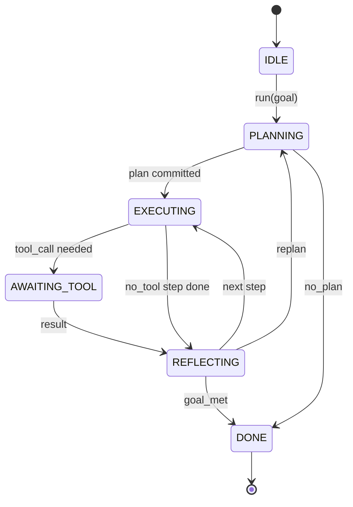

# Agent Harness Loop Contract

A deterministic, resumable agent-harness loop in Python. The model is a
coprocessor; the harness owns the state machine, lifecycle hooks, pull points,
budget envelope, and typed event stream.

This module implements the capstone specification **Agent Harness Loop
Contract**. It deliberately contains no model call, tool process, transport, or
network access. A caller supplies the draft plan (or uses the deterministic
planner) and answers tool pulls with typed results. Everything else is the
contract that the next lessons plug into.

## Contract at a glance

| Surface | Count | Values |
|---|---:|---|
| States | 6 | `IDLE`, `PLANNING`, `EXECUTING`, `AWAITING_TOOL`, `REFLECTING`, `DONE` |
| Hook topics | 10 | `before_plan`, `after_plan`, `before_tool_call`, `after_tool_call`, `before_step`, `after_step`, `on_error`, `on_pause`, `on_budget_exceeded`, `on_complete` |
| Pull points | 2 | tool pull from `AWAITING_TOOL`; pause pull from any active state |
| Event types | 11 | `session.start`, `plan.draft`, `plan.commit`, `step.start`, `step.end`, `tool.call`, `tool.result`, `tool.error`, `budget.warn`, `session.pause`, `session.complete` |
| Budget limits | 3 | turns, tool calls, wall-clock seconds |

## Architecture

```text
main.py                     offline demo, caller-side tool fixtures
src/agent_harness/
  contract.py               enums, legal-transition table, error classes
  budget.py                 allowance counters, extension, snapshots
  events.py                 append-only stream, deep freeze, replay, subscriptions
  hooks.py                  ordered registry, signals, failures
  planner.py                PlanStep, ToolCall, Planner protocol, deterministic plan
  loop.py                   HarnessLoop generator, pull/result DTOs, transitions
tests/
  test_contract.py          exact vocabulary, guards, no-plan path
  test_loop.py              happy path, exact event/transition order, determinism
  test_hooks.py             firing order, mutation, aborts, review pauses
  test_budget.py            turn/tool/wall-clock pauses, extensions, close
  test_events.py            immutability, replay, live observers, failure isolation
```



`IDLE` is the only entry point; `DONE` is the only exit. A pause is not a sixth
active state: `HarnessLoop` transitions the session to `IDLE`, records the
suspended state in `PauseInfo.resume_state`, and restores it on `resume(...)`.
The `REFLECTING -> PLANNING` edge is declared in `LEGAL_TRANSITIONS` for the
published contract; this lesson's deterministic planner never requests replan.
`HarnessLoop.transitions` exposes every edge taken, including pause and resume.

### Pull points

`run()` and `resume()` return a `PullRequest | SessionResult`. They never raise
to communicate "I need something".

```python
from agent_harness import (
    BudgetExtension, HarnessLoop, PullKind, PullRequest,
    ResumeDecision, ToolResult,
)

loop = HarnessLoop()
outcome = loop.run("validate the loop contract")
while isinstance(outcome, PullRequest):
    if outcome.kind is PullKind.TOOL:
        call = outcome.call
        assert call is not None
        outcome = loop.resume(ToolResult(call.call_id, data={"ok": True}))
    else:
        assert outcome.pause is not None
        outcome = loop.resume(ResumeDecision(BudgetExtension(turns=1)))
assert outcome.outcome.value == "goal_met"
```

A tool pull is the caller's tool transport: execute the call outside the loop,
then resume with a matching `ToolResult`. A pause pull is the budget or
human-review seam: extend the matching limit and resume, or call `close()`.
`PullRequest.event_offset` is the next event-stream cursor, so a UI can replay
what happened before the pull.

### Hooks

Hooks run in registration order. They may mutate the shared payload, return
`HookSignal.SKIP_STEP` / `HookSignal.PAUSE`, or raise. The loop consumes only
three mutations: `before_plan.payload["goal"]`, `after_plan.payload["plan"]`,
and `before_tool_call.payload["call"]`. A failing hook stops later subscribers
for that topic and is recorded in `HookRegistry.failures`.

Failure scope is explicit:

- planning-hook failures abort the session (`aborted`);
- tool-hook failures abort the turn, emit `tool.error`, mark the step failed,
  and continue the session (`incomplete`);
- failures in `on_error`, `on_pause`, `on_budget_exceeded`, and `on_complete`
  are recorded but never recurse or abort.

`HookSignal.PAUSE` is the review path. The caller gets a pause pull and resumes
without re-firing the hook that asked for review.

### Events

Events are observational only; hook payloads are not duplicated into them. The
stream is in-memory, append-only, deeply frozen, and offers `replay(offset)` plus
live subscriptions. An observer exception is captured in `EventStream.failures`
and never reaches the loop.

### Budgets

Counters are allowances checked immediately before the operation they govern:

- `max_turns=1` allows one step, then pauses before a second step starts;
- `max_tool_calls=1` allows and delivers one ToolResult request, then pauses
  before a second call is emitted;
- wall clock is sampled at each transition checkpoint and pauses before the next
  operation.

Reaching a limit is a yield, not a kill. `budget.warn` carries the limit and
current/maximum values; `session.pause` carries the frozen budget snapshot. A
resume must extend the exhausted limit by a positive amount, otherwise
`BudgetNotExtended` is raised and the session stays paused. Counters survive an
extension. `close()` at a pause ends with the `closed` outcome.

## Quickstart

Prerequisites: Python 3.11+ and [uv](https://docs.astral.sh/uv/).

```bash
cd 20-agent-harness-loop-contract
./verify.sh
.venv/bin/python main.py
```

`verify.sh` installs the pinned dev-only dependencies into `.venv/`, runs the
tests, typechecks with strict mypy, and executes the offline demo. It is safe to
run repeatedly. A first run may download the pinned wheels if they are not in
the uv cache; tests themselves make no network calls.

The demo runs two deterministic sessions and prints their event stream:

- normal session: 14 events, 3 turns, 2 tool calls, `goal_met`;
- budget session: `max_turns=2`, one pause at the turn limit, extension by one
  turn, then `goal_met`.

## What runs offline

Everything in this repository runs offline. The planner is deterministic; the
demo's tool answers are local fixtures; tests use a fake clock and scripted
`ToolResult` values. There are no API keys, no `.env` file, no sockets, no
subprocess tool execution, and no GPU requirement. The only network access
possible is uv fetching pinned development wheels when `.venv/` does not exist
and the cache is empty.

## Real-provider and GPU boundary

This lesson intentionally has no model or tool implementation; a real provider
is not called and no GPU path is present. The extension seams are:

- `Planner.plan(goal) -> Sequence[PlanStep]` for a model-backed planner;
- the tool pull: `PullRequest.call` is a `ToolCall`, and the caller resumes with
  `ToolResult(call_id, ok, data, error)`.

A later lesson can wrap an HTTP model client in a `Planner` implementation and a
tool registry in the caller-side drain loop without changing `HarnessLoop`,
hooks, events, or budget semantics. The harness is synchronous and blocking, so
a provider adapter must complete (or return a draft) before `plan()` returns;
streaming model output belongs in a future transport layer, not in this
contract. No credentials or network configuration belong in this module.

## Measured results

Measured locally with CPython 3.14.10, pytest 9.2.0, and mypy 2.4.1 from the
pinned lock file:

- `./verify.sh` exits 0 twice in a row; 31 tests pass and mypy reports
  `Success: no issues found in 8 source files`.
- Normal demo: 14 events, `outcome=goal_met`, `turns=3`, `tool_calls=2`,
  `completed=3`, `failed=0`, `skipped=0`, `elapsed_s=0.25` (manual demo clock).
- Budget demo: 16 events, one `budget.warn` + `session.pause` pair at the
  `turns=2/2` limit, extension by one turn, then `goal_met`, `turns=3`,
  `tool_calls=2`, `elapsed_s=0.50`.
- No benchmark claims: elapsed values are deterministic demo-clock values, not
  provider latency measurements.

## Limitations

- One in-memory session per `HarnessLoop`; there is no durable checkpoint. A
  process exit loses the suspended generator state.
- The event stream is append-only but not persisted, thread-safe, or
  multi-reader coordinated. Persist `as_dict()` output externally if needed.
- The deterministic planner always returns the same three steps; the
  `REFLECTING -> PLANNING` edge is declared but has no planner trigger in this
  lesson.
- Tool results are typed at the envelope boundary (`call_id`, `ok`, `error`) but
  arbitrary tool payloads are not schema-validated. A malformed result envelope
  or mismatched call id is rejected with `ProtocolError` and leaves the pull
  resumable.
- Wall clock is sampled at transition checkpoints, not by a preemptive timer;
  long blocking hook or tool work is the caller's concern.
- `close()` is legal only while paused. Abandoning a tool pull is not supported;
  supply a `ToolResult` or use a later transport layer.

## Design decisions

- **Harness as state machine:** all state changes go through `_transition` and
  append an auditable `Transition`; the published legal map is explicit.
- **Generator pull points:** Python generator suspension preserves mid-step
  locals across pauses. A pause restores the exact active state instead of
  restarting the step.
- **Allowance budgets:** a limit allows the operation that consumes the last
  unit. This prevents a tool result from being blocked after its call was
  already delivered, and gives the caller a clean extend/close decision.
- **Orthogonal hooks and events:** hooks are imperative and can mutate or abort;
  events are frozen observations and cannot change loop behavior.
- **Failure containment:** active hook failures are scoped; observer and safe
  lifecycle failures are recorded without recursive aborts.

## References

These sources informed the hook vocabulary, lifecycle boundaries, and
pause/resume semantics. The implementation is original; no source code was
copied.

1. AI Engineering From Scratch, “Agent Harness Loop Contract” capstone
   specification — states, hook topics, pull points, events, and budget
   requirements. <https://aiengineeringfromscratch.com/learn/capstone-projects/agent-harness-loop-contract>
2. Claude Code documentation, “Hooks reference” — lifecycle hook categories,
   before/after tool hooks, blocking and observation behavior.
   <https://code.claude.com/docs/en/hooks>
3. Cursor documentation, “Hooks” — before/after agent stages, input/output
   mutation, and policy hooks over tool execution.
   <https://cursor.com/docs/hooks>
4. OpenAI Agents SDK, “Lifecycle” — run, agent, LLM, and tool start/end
   callbacks used to shape the hook topic set.
   <https://openai.github.io/openai-agents-python/ref/lifecycle/>
5. LangGraph documentation, “Interrupts” — pausing with a serialisable payload,
   resuming with an input value, and continuing from a saved position.
   <https://docs.langchain.com/oss/python/langgraph/interrupts>

## License

MIT © 2026 Pedro Monteiro. See `LICENSE`.
