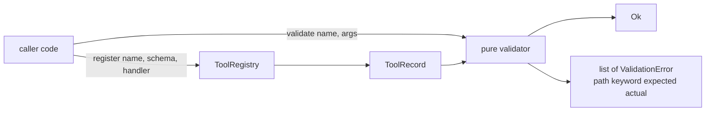

# Tool Registry with Schema Validation

A tool the agent cannot validate is a tool the agent cannot call. This module
implements the registry and the checker before the tools: a typed catalog of
`name → schema → handler`, plus a pure recursive validator for a closed JSON
Schema 2020-12 subset. Validation failures carry RFC 6901 JSON Pointer paths so
a model can repair its arguments in the next call instead of guessing from a
handler traceback.

The schema is data. The handler is opaque code. The registry never calls a
handler during validation, and the validator never coerces types. The registry
is a shape boundary, not a security sandbox; timeouts, sandboxing, and dispatch
belong to the next lesson.

## Contract at a glance

| Surface | Values |
|---|---|
| `ToolRecord` | `name`, `description`, `schema`, `handler`, `idempotent`, `timeout_ms` |
| Registration | `register(name, schema, handler, *, description="", idempotent=False, timeout_ms=30_000, override=False)` |
| Reads | `get(name)`, `validate(name, args)`, `names()` |
| Validation result | `Ok()` or `list[ValidationError]` |
| Error fields | `path`, `keyword`, `message`, `expected`, `actual` |
| Tool name | lowercase alphanumeric/underscore segments separated by dots |
| Default timeout | `DEFAULT_TIMEOUT_MS = 30_000`; stored, not enforced here |

The validator is one recursive pass. It aggregates every failure, does not stop
at the first one, and reports errors in this deterministic order per node:
`enum`, `type`, string constraints, `required`, `properties`, `items`.

## Architecture

```text
main.py                       deterministic offline demo and handlers
src/tool_registry/
  __init__.py                 public exports
  schema.py                   pure validator, schema checker, error types
  registry.py                 ToolRecord, Ok, ToolRegistry, registration rules
tests/
  test_schema.py              keyword semantics, paths, equality, purity
  test_schema_meta.py         schema boundary and annotation policy
  test_schema_edges.py        escaping, nested pointers, non-mutation
  test_registry.py            registration, override, snapshots, errors
```



`register` checks the schema once at the boundary. `validate` trusts that checked
schema and walks it against the instance; it reads no clock, performs no I/O,
and can be replayed over a log. `ToolRecord` is frozen, and the registry keeps a
deep copy of the schema supplied at registration.

## Quickstart

Prerequisites: Python 3.11+ and [uv](https://docs.astral.sh/uv/).

```bash
cd 21-tool-registry-schema-validation
./verify.sh
.venv/bin/python main.py
```

`verify.sh` installs the pinned dev-only dependencies into the ignored `.venv/`
and `.uv-cache/` directories, runs pytest, typechecks with strict mypy, and
executes the demo. It is safe to run repeatedly. The first run may download the
pinned wheels; the tests themselves make no network calls.

For direct library use, add `src` to the import path:

```bash
PYTHONPATH=src .venv/bin/python - <<'PY'
from tool_registry import Ok, ToolRegistry

registry = ToolRegistry()
registry.register(
    "math.add",
    {
        "type": "object",
        "properties": {"a": {"type": "number"}, "b": {"type": "number"}},
        "required": ["a", "b"],
    },
    lambda a, b: a + b,
    description="Add two numbers",
    idempotent=True,
)

outcome = registry.validate("math.add", {"a": 1, "b": 2})
assert isinstance(outcome, Ok)
for error in registry.validate("math.add", {"a": "1", "b": 2}):
    print(error.to_dict())
PY
```

The demo registers `weather.get_forecast`, `math.add`, and `text.word_count`,
prints the ordered names, shows three repair-ready errors for a bad forecast
call, then validates the corrected call and prints the deterministic forecast.

## The supported subset

| Keyword | Behavior |
|---|---|
| `type` | One of `string`, `number`, `integer`, `boolean`, `object`, `array`, `null`, or a non-empty list of unique type names. `integer` accepts `3` and `3.0`, rejects `3.5` and `True`. `number` rejects numeric strings and booleans. No coercion. |
| `properties` | Recurses into each present property. Keys absent from `properties` are allowed; `additionalProperties` is intentionally not implemented. |
| `required` | Every listed property must be present. A missing property is reported at the missing property's pointer, for example `/user/email`. |
| `enum` | Non-empty list of primitive JSON values. Uses JSON equality: `1` equals `1.0`, but `True` is not `1` and `False` is not `0`. |
| `minLength` / `maxLength` | Inclusive bounds on Unicode code points for strings. |
| `pattern` | ECMA-262-style pattern evaluated with Python `re.search`, so it is unanchored. The pattern is compiled at registration; an invalid pattern is rejected there. |
| `items` | Recurses into every array element. Errors point at the element, for example `/tags/1`. |

Annotation metadata (`$schema`, `$id`, `$comment`, `title`, `description`,
`default`, `examples`, `deprecated`, `readOnly`, `writeOnly`) is accepted and
ignored. Every other keyword is rejected by `check_schema`; silently ignoring an
unimplemented assertion would make the registry claim a guarantee it does not
provide. In particular, `$ref`, `oneOf`, `anyOf`, `allOf`, conditionals,
`additionalProperties`, numeric bounds, array-count bounds, `format`, and
`const` are outside this lesson.

A failed call looks like this (from the demo):

```json
[
  {
    "path": "/city",
    "keyword": "minLength",
    "message": "string length 1 is below minLength 2",
    "expected": 2,
    "actual": 1
  },
  {
    "path": "/days",
    "keyword": "type",
    "message": "expected type integer, got string",
    "expected": "integer",
    "actual": "string"
  },
  {
    "path": "/units",
    "keyword": "enum",
    "message": "value is not one of the allowed enum values",
    "expected": ["metric", "imperial"],
    "actual": "\"kelvin\""
  }
]
```

Root failures use the empty string pointer `""`; property tokens escape `~` as
`~0` and `/` as `~1`, as required by RFC 6901.

## What runs offline

Everything in the repository runs offline. The forecast, addition, and word
count handlers are local and deterministic. There are no API keys, `.env` files,
sockets, subprocess tool executions, model calls, or GPU requirements. The only
possible network access is uv fetching pinned development wheels when `.venv/`
does not exist and the local cache is empty.

## Real-provider and GPU boundary

This lesson has no model provider, remote API, or GPU path. A real tool plugs in
by replacing a demo handler body with a client call:

```python
def get_forecast(city: str, days: int, units: str = "metric") -> dict[str, object]:
    return real_weather_client.forecast(city, days, units)
```

Validation, registration, and error paths remain identical and offline. The
demo's weather data is a synthetic fixture, not a forecast. `timeout_ms` is
stored for the future dispatcher; this registry does not enforce it.

## Measured results

Measured locally with CPython 3.14.10, pytest 9.2.0, and mypy 2.4.1 from the
pinned lock file:

- `./verify.sh` exits 0; a second consecutive run also exits 0.
- 112 tests pass. Strict mypy reports
  `Success: no issues found in 4 source files`.
- The complete verification takes about 0.4 seconds on this workstation after
  dependencies are installed. This is a local wall-clock observation, not a
  benchmark.
- The demo reports 3 errors for the bad forecast call (`/city` `minLength`,
  `/days` `type`, `/units` `enum`), then `Ok()` for the corrected call, a
  two-day synthetic forecast, a duplicate-registration rejection, and an
  invalid-schema rejection.

No provider latency, token count, GPU throughput, or benchmark claims are made.

## Limitations

- Not a full JSON Schema engine: no `$ref`, `oneOf`, `anyOf`, `allOf`,
  `if`/`then`/`else`, `additionalProperties`, numeric bounds, array-count
  bounds, `format`, or `const`.
- No defaults, coercion, or silent truncation. A string `"42"` never satisfies a
  number schema.
- `enum` values are primitives only, per the lesson subset.
- `pattern` uses Python `re`, which covers the common ECMA-262 subset but is not
  a JavaScript regex engine.
- `$schema` is accepted as metadata, but the documented subset always applies.
- `ToolRecord` is frozen, but `record.schema` is an ordinary dictionary. Treat
  returned records as read-only and do not mutate their schemas.
- Extra object properties pass because `additionalProperties` is not
  implemented.
- No dispatch, timeout enforcement, sandbox, persistence, or thread safety. The
  registry is in-memory and is not a security boundary.
- Annotation values are not interpreted or validated.

## Design decisions

- **Registry before tools:** the record pins name, schema, handler, idempotency,
  and timeout; later layers can stop guessing.
- **Closed subset, loud failure:** unsupported assertion keywords raise
  `SchemaError` at registration instead of silently passing. Annotations are
  no-op metadata.
- **JSON Pointer paths:** paths point into the instance; missing `required`
  properties point at the missing property itself.
- **Deterministic aggregation:** every failure is returned, ordered by the walk,
  so a replay log produces the same list.
- **JSON equality:** booleans are never numbers; integers and mathematically
  equal floats compare equal; strings compare exactly.
- **Registration hygiene:** duplicate names require `override=True`; an override
  preserves registration order and either fully replaces the record or leaves
  the previous one untouched.
- **Schema snapshots:** the registry deep-copies the schema at registration, so
  later mutation of the caller's dictionary cannot change validation.
- **Purity:** validation reads only the schema and instance; it does not call
  handlers, use the clock, or mutate inputs.
- **Conventional timeout:** `timeout_ms` defaults to 30,000 ms and is stored for
  the dispatcher; no timeout behavior is implemented here.

## References

These sources informed the subset, error paths, and registry contract. The
implementation is original; no source code was copied.

1. AI Engineering From Scratch, “Tool Registry with Schema Validation” capstone
   specification — record fields, eight keywords, registration/override, and
   pointer-shaped errors.
   <https://aiengineeringfromscratch.com/learn/capstone-projects/tool-registry-schema-validation>
2. JSON Schema Validation 2020-12 — `type`, `enum`, `required`, string length,
   `pattern`, and `items` semantics, including integer handling.
   <https://json-schema.org/draft/2020-12/json-schema-validation>
3. JSON Schema Core 2020-12 — JSON data-model equality, arbitrary-precision
   numbers, regex interoperability, and treatment of unknown keywords.
   <https://json-schema.org/draft/2020-12/json-schema-core>
4. RFC 6901, “JavaScript Object Notation (JSON) Pointer” — pointer syntax and
   `~0` / `~1` escaping.
   <https://www.rfc-editor.org/rfc/rfc6901>
5. Model Context Protocol 2026-07-28, “Tools” — `inputSchema` expectations,
   JSON Schema 2020-12 default, and deterministic tool ordering.
   <https://modelcontextprotocol.io/specification/2026-07-28/server/tools>

## License

MIT © 2026 Pedro Monteiro. See `LICENSE`.
