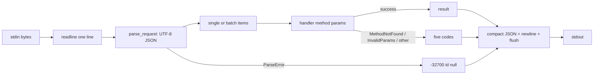

# JSON-RPC 2.0 over Newline-Delimited Stdio

The transport between a model client and a tool server is JSON-RPC over stdio.
This module hand-rolls that transport: one UTF-8 JSON message per newline,
the five standard error codes, notifications that are never answered, batches
whose array shape survives, and a dispatch loop that keeps reading after bad
input. The application sees only `handler(method, params)`; the transport never
sees a tool registry.

The same code runs over an in-memory `BytesIO` pair and over a real child
process's standard streams. The demo is self-terminating; `--serve` is the
real-pipe mode. Everything is deterministic and offline.

## Contract at a glance

| Surface | Values |
|---|---|
| Error constants | `PARSE_ERROR = -32700`, `INVALID_REQUEST = -32600`, `METHOD_NOT_FOUND = -32601`, `INVALID_PARAMS = -32602`, `INTERNAL_ERROR = -32603` |
| `parse_request(raw)` | One line (`bytes`) → `ParsedDocument`; raises `ParseError` for invalid UTF-8/JSON |
| `ParsedDocument` | `items: tuple[Request \| Notification \| InvalidRequest, ...]`, `is_batch: bool` |
| `Request` | `method`, `params`, required `id` (a null id is still a request) |
| `Notification` | `method`, `params`; no id, never answered |
| `InvalidRequest` | `reason` (diagnostic only), optional echoed `id` |
| `StdioTransport` | `(handler, stdin, stdout)`, `.serve()` |
| Handler | `handler(method: str, params: dict \| list) -> object` |
| Writers | `write_response(id, result)`, `write_error(id, code, message, data=None)`, `write_notification(method, params=None)` |
| Missing `params` | Passed to the handler as a fresh `{}` |
| Wire serialization | Compact JSON, UTF-8, `allow_nan=False`, one `\n`, flush |

`params` that is present must be an object or an array. Explicit `params: null`
is an invalid envelope, not an empty parameter object. A fractional numeric id
is accepted because the JSON-RPC specification says SHOULD NOT, not MUST NOT.

## Wire shapes

All examples are exactly one line on the wire.

```text
request       {"jsonrpc":"2.0","id":7,"method":"demo.echo","params":{"text":"hi"}}
success       {"jsonrpc":"2.0","id":7,"result":{"text":"hi"}}
notification  {"jsonrpc":"2.0","method":"progress","params":{"step":1}}
error         {"jsonrpc":"2.0","id":7,"error":{"code":-32601,"message":"Method not found"}}
batch in      [{"jsonrpc":"2.0","method":"demo.log"},{"jsonrpc":"2.0","id":"x","method":"demo.echo"}]
batch out     [{"jsonrpc":"2.0","id":"x","result":{}}]
```

A batch reply is a JSON array on one line, even when it contains one response.
If every batch entry is a notification, nothing is written. An empty batch is
not an empty array reply: it produces one `-32600` object with `id: null`, as
the base specification requires. Invalid entries inside a non-empty batch each
produce a response, and valid entries in the same batch still run.

## Error semantics

| Code | Message | When |
|---|---|---|
| `-32700` | `Parse error` | Invalid UTF-8, invalid/truncated JSON, a blank line, a BOM, extra JSON data, or `NaN`/`Infinity`; response id is `null` |
| `-32600` | `Invalid Request` | Envelope is not an object, `jsonrpc` is not exactly `"2.0"`, method is not a string, params is not an object/array, or id is not a string/number/null |
| `-32601` | `Method not found` | The handler raised `MethodNotFound` |
| `-32602` | `Invalid params` | The handler raised `InvalidParams`; its message is used, or `Invalid params` if empty |
| `-32603` | `Internal error` | Any other handler exception, or a result that cannot be serialized; `data.exception` contains only the exception class name |

A valid id is echoed on `-32600` so a client can correlate the failure. Only an
absent, unparseable, or invalid id becomes `null`. The base specification's
conservative reading of "error in detecting the id" would use `null` for every
Invalid Request; the lesson's stream table explicitly echoes `X`, and that is
the choice here.

Notifications have no response channel. A handler exception while processing a
notification is swallowed by design. Outbound notifications written by the
handler during a request are sent immediately, so a progress flow can emit
`progress`, `progress`, then the final response on the same stream.

## Architecture

```text
main.py                       BytesIO demo, deterministic methods, --serve mode
bench.py                      local throughput reference
src/jsonrpc_stdio/
  __init__.py                 public exports and version
  transport.py                envelopes, parser, StdioTransport, dispatch loop
tests/
  test_parse.py               envelope classification and parse failures
  test_transport.py           wire codes, batches, notifications, writers
  test_subprocess_stdio.py    real OS pipes, EOF, no stdout contamination
verify.sh                     frozen install, pytest, strict mypy, demo
```



The reader is one loop until EOF. It never resynchronizes by scanning for
another delimiter: each `readline()` already returned exactly one frame. A bad
frame is answered and discarded; the next frame is parsed fresh.

Each message is fully serialized before any bytes are written. A handler result
that cannot be encoded (a set, bytes, `NaN`, a circular structure) becomes
`-32603` rather than a partial line. The writer checks the byte count returned
by `stdout.write` and flushes after every message, which is required for an
interactive pipe.

The transport is single-threaded and synchronous. The handler is called in the
same loop that reads the next line, so progress notifications are ordered
deterministically. There are no locks.

## Quickstart

Prerequisites: Python 3.11+ and [uv](https://docs.astral.sh/uv/).

From a fresh clone of the track repository:

```bash
cd agent-harness-from-scratch/22-jsonrpc-stdio-transport
./verify.sh
```

`verify.sh` installs the pinned dev dependencies into the ignored `.venv/`,
runs the tests and strict mypy, then runs the demo. It is safe to run twice.

Run the self-terminating demo:

```bash
.venv/bin/python main.py
```

It prints nine input lines and ten output messages, including all five error
codes, then ends with:

```text
demo verified: 9 input lines, 10 output messages
```

Run the same deterministic methods over real stdio:

```bash
printf '%s\n' \
  '{"jsonrpc":"2.0","id":1,"method":"demo.echo","params":{"text":"hi"}}' \
  | .venv/bin/python main.py --serve
```

Output:

```json
{"jsonrpc":"2.0","id":1,"result":{"text":"hi"}}
```

Measure the local transport:

```bash
.venv/bin/python bench.py --requests 20000 --repeat 3
```

## What runs offline

All tests, the demo, and the benchmark run offline after the one-time dependency
sync. There are no network calls, API keys, model providers, GPUs, or remote
sandboxes in the test suite. The real-pipe test spawns a local Python child
process; it does not contact a service.

There is no separate provider mode to simulate. The protocol boundary is the
handler:

```python
import sys

from jsonrpc_stdio import StdioTransport

transport = StdioTransport(handler, sys.stdin.buffer, sys.stdout.buffer)
transport.serve()
```

A real tool registry, model dispatcher, or MCP-style server plugs in behind
`handler(method, params)` and can use `StdioTransport.write_notification(...)`
for progress. A model provider would live behind that handler; the transport
does not know what a tool or a model is. This module is the transport, not a
provider adapter.

## Measured results

Measured locally on this workstation; these are observations from one run, not
benchmark guarantees for other machines.

- `./verify.sh`: **45 test cases pass**, strict mypy reports `Success: no issues
  found in 4 source files`, and the demo exits 0.
- Demo: **9 input lines → 10 output messages**; parse error, invalid request,
  method not found, invalid params, and internal error are all exercised.
- `bench.py --requests 20000 --repeat 3` (median), Python 3.14.10 on Linux
  x86_64:
  - full parse/validate/dispatch/serialize path: **141,217 req/s**,
    **7.08 µs/frame**, **21.0 MiB/s** round-trip bytes;
  - bare `json.loads` + `json.dumps` reference: **234,853 req/s**;
  - overhead factor: **1.66×** (baseline / transport).

The baseline performs no envelope validation, dispatch, or response-shape
work, so it is a framing reference rather than an alternative implementation.

## Design decisions

- **Return envelope errors, raise syntax errors.** `parse_request` raises
  `ParseError` for a bad line so the loop can answer `-32700`; invalid
  envelopes become `InvalidRequest` items so one bad batch entry does not
  discard its siblings.
- **Echo a valid id on Invalid Request.** Correlation beats the strictest
  reading of the base spec; the README states the difference explicitly.
- **Empty batch is one object.** `[]` normalizes to a non-batch `-32600`
  response, matching the specification's explicit example.
- **Batch order is input order.** The spec permits any order; deterministic
  order makes transcripts and tests stable.
- **Notifications are never answered.** A notification that fails is still
  silent because there is no response channel to report failure on.
- **Only the exception class is exposed.** Internal error data is
  `{"exception": "ValueError"}`, not the exception message, which could leak
  implementation detail.
- **Absent params are `{}`.** Handlers get a predictable shape; explicit
  `null` remains invalid because it is not a structured parameter value.
- **Non-standard constants are rejected.** `NaN` and `Infinity` are not JSON;
  Python's lenient defaults are disabled on both parse and serialize.
- **Encode before write.** A serialization failure becomes `-32603` without
  emitting half a frame; every line is flushed.
- **No maximum frame.** The peer is assumed to be a trusted local process.
  Production transports add a size bound, timeouts, and cancellation.

## Limitations

- Server role only: inbound response objects are not handled; an object without
  a string `method` is `-32600`.
- No Content-Length framing, content-type negotiation, or MCP initialization
  handshake. This is newline-delimited JSON-RPC, not a complete MCP server.
- No cancellation channel, outer trace/correlation id, subscriptions, or
  request timeouts.
- No concurrent dispatch; batches are processed sequentially even though the
  wire allows any completion order.
- No maximum line/frame size and no backpressure policy beyond blocking I/O.
- Notification failures are unobservable by design; there is no stderr logging
  hook.
- Reserved `rpc.` method names are not policed by the transport; the handler
  owns that policy.
- No persistence, retries, authentication, or sandboxing; this is a local
  transport, not a security boundary for untrusted peers.

## References

These sources informed the framing, envelope rules, and error semantics. The
implementation is original; no source code was copied.

1. AI Engineering From Scratch, "JSON-RPC 2.0 Over Newline-Delimited Stdio"
   capstone specification — the five error codes, stream continuation,
   notifications, batches, and the `BytesIO` demo.
   <https://aiengineeringfromscratch.com/learn/capstone-projects/jsonrpc-stdio-transport>
2. JSON-RPC 2.0 Specification — request/response/notification shapes, batch
   rules, reserved error codes, and id semantics.
   <https://www.jsonrpc.org/specification>
3. JSON Lines — UTF-8 encoding, one JSON value per line, `\n` framing, and the
   rule that a blank line is not a value.
   <https://jsonlines.org/>
4. Model Context Protocol 2026-07-28, "stdio" transport — a current production
   example of newline-delimited JSON-RPC over stdio, stderr logging, and EOF
   shutdown.
   <https://modelcontextprotocol.io/specification/2026-07-28/basic/transports/stdio>
5. Python `json` documentation — `parse_constant`, `allow_nan=False`, compact
   separators, and the warning that JSON is not a framed protocol.
   <https://docs.python.org/3/library/json.html>

## License

MIT © 2026 Pedro Monteiro. See `LICENSE`.
