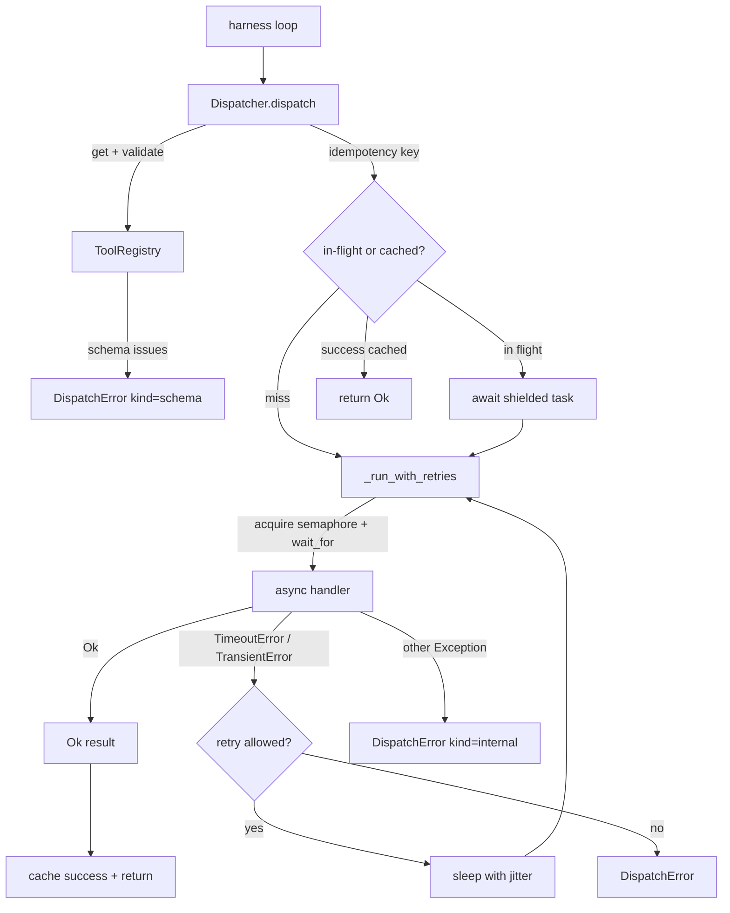

# Function Call Dispatcher

The dispatcher is where the harness pays for every promise the tool schema
made. This module sits between an agent loop and a tool registry and owns the
mechanics the rest of the loop should not: per-attempt timeouts, jittered
retries, idempotency-key dedupe, one typed error envelope, and a bounded
fan-out.

Three properties define the seam:

- **One failure shape.** Every failed call is a `DispatchError` with a `kind`,
  `attempts`, and a JSON-RPC code. A handler exception never escapes as an
  arbitrary traceback.
- **Retries are evidence-driven.** A timeout only retries for tools marked
  idempotent. A handler that raises `TransientError` declares its own failure
  retryable. Schema, not-found, and internal failures never consume a retry.
- **The caller owns the idempotency key.** The dispatcher never invents keys
  and never derives them from arguments. Concurrent calls sharing a key
  collapse onto one handler invocation; successful outcomes are cached for 60
  seconds by default to absorb late retries.

Everything runs offline. The demo's tools are deterministic fixtures, not a
wrapper around a paid API.

## Contract at a glance

| Surface | Values |
|---|---|
| `Dispatcher(registry, *, max_concurrency=8, max_attempts=3, base_delay=0.1, cache_ttl=60.0, max_cache_entries=1024, sleep=..., jitter=..., clock=..., on_event=None)` | The only constructor |
| `dispatch(name, args=None, *, idempotency_key=None, timeout_ms=None, budget=None)` | Returns `Ok` or `DispatchError` |
| `gather_bounded(calls)` | `list[Ok \| DispatchError]` in input order |
| `Call(name, args={}, idempotency_key=None, timeout_ms=None, budget=None)` | One fan-out entry |
| `ToolRecord` | `name`, `schema`, `handler`, `description`, `idempotent`, `timeout_ms` |
| `ToolRegistry.register(name, schema, handler, *, description="", idempotent=False, timeout_ms=30_000, override=False)` | Registers an async callable |
| `ToolRegistry.get(name)` / `validate(name, args)` / `names()` | Registry reads |
| `Ok(value)` | Tagged success; handler return values are not serialized |
| `DispatchError(kind, message, attempts, jsonrpc_code)` | The single failure shape |
| `TransientError` | Handler-declared retryable failure |
| `ToolCallBudget(limit)` | `try_consume()` / `used` / `remaining` |
| Events | `dispatch.attempt`, `dispatch.retry` |

`ToolRegistry` here is a compact local fixture so this module is independently
verifiable and does not import sibling modules. The `Registry` protocol is the
integration seam: a production registry only needs `get(name)` and
`validate(name, args)` to plug into the same dispatcher.

### Error envelope

| `kind` | `jsonrpc_code` | `attempts` | Retries? |
|---|---|---:|---|
| `schema` | `-32602` (`INVALID_PARAMS`) | 0 | never |
| `not_found` | `-32601` (`METHOD_NOT_FOUND`) | 0 | never |
| `timeout` | `-32603` (`INTERNAL_ERROR`) | actual | only if `idempotent=True` |
| `transient` | `-32603` | actual | while attempts remain |
| `internal` | `-32603` | actual | never |
| `budget_exceeded` | `-32603` | attempts already made | never |

`attempts` counts handler invocations. Schema rejection, unknown tools, and a
budget that is empty before the first attempt are therefore `0`. A timeout on
a non-idempotent tool is `1` because the handler ran once and may or may not
have committed.

`DispatchError.to_jsonrpc(request_id)` renders the wire object:

```json
{"jsonrpc":"2.0","id":"id-1","error":{"code":-32601,"message":"unknown tool 'missing'"}}
```

The dispatcher deliberately does not include tracebacks, exception objects, or
handler arguments in the envelope. Internal messages contain only the
exception class and a truncated message so a model can repair obvious errors
without exposing a stack trace.

### Retry schedule

The default policy is three attempts. Only `timeout` (idempotent tools) and
`transient` failures retry.

| Failed attempt | Base delay | Actual delay with jitter |
|---:|---:|---|
| 1 | 0.1 s | `0.1 × (1 + U[0, 0.5])` |
| 2 | 0.4 s | `0.4 × (1 + U[0, 0.5])` |

`base_delay` is configurable but defaults to `0.1`; the multiplier is fixed at
4 so the second wait is `0.4 s` base. Tests and the demo inject a deterministic
sleeper and `jitter=lambda: 0.0`, so they observe exactly `[0.1, 0.4]` without
sleeping. The default production path uses `random.random`.

## Architecture

```text
main.py                       seven self-verifying offline scenarios
bench.py                      local dispatch throughput measurement
src/function_dispatcher/
  __init__.py                 public exports
  errors.py                   error kinds, codes, DispatchError, TransientError
  registry.py                 records, names, closed schema subset
  budget.py                   Budget protocol, ToolCallBudget
  dispatcher.py               timeout/retry/dedupe/fan-out
tests/
  test_registry.py            registration, validation, snapshots
  test_dispatcher.py          success, errors, timeouts, retries, budgets, events
  test_idempotency.py         in-flight dedupe, TTL, error non-caching, eviction
  test_concurrency.py         bounded fan-out, order, mixed outcomes
```



### One call in order

1. Copy the argument mapping once. A later mutation by the caller cannot
   change the attempt.
2. Validate the per-call `timeout_ms` override and `idempotency_key`
   (`None` or non-empty string). Invalid options are programmer errors and
   raise `ValueError`.
3. Look up the tool. A miss returns `not_found` without touching the handler
   or idempotency cache.
4. Validate arguments through the registry. Every failure is reported, in
   deterministic order, with JSON-Pointer paths. A schema failure returns
   before the cache and budget.
5. Resolve the effective timeout: per-call override, else the registry record.
6. With a key, coalesce onto a pending task or return a cached success. Without
   a key, run directly.
7. Before each handler attempt, consume one tool-call budget unit. Empty budget
   returns `budget_exceeded`.
8. Acquire the dispatcher's single semaphore, run
   `asyncio.wait_for(handler(**args), timeout_ms / 1000)`, release the
   semaphore. A timeout cancels the handler; `wait_for` waits for that
   cancellation to finish.
9. Map the outcome, emit `dispatch.attempt`, retry with backoff if allowed,
   then return `Ok` or `DispatchError`.

`gather_bounded` builds one `dispatch` coroutine per `Call` and returns
`asyncio.gather`'s results in input order. It adds no second semaphore because
every handler attempt already uses the shared limit. A fan-out of 40 with the
default limit has at most 8 handlers running at once; backoff sleeps and
waiters on an in-flight key do not hold slots.

## Quickstart

Requires Python 3.11+ and [uv](https://docs.astral.sh/uv/).

From a fresh clone of the track repository:

```bash
cd 23-function-call-dispatcher
./verify.sh
.venv/bin/python main.py
.venv/bin/python bench.py
```

`verify.sh` is safe to run twice. It installs the pinned dev dependencies into
`.venv` and `.uv-cache` (both ignored), runs the test suite, runs strict mypy
over `src`, `main.py`, and `bench.py`, then runs the demo.

Expected demo shape:

```text
{"scenario":"schema_error","kind":"schema","attempts":0,"code":-32602}
{"scenario":"timeout","kind":"timeout","attempts":1,"cancelled":true}
{"scenario":"retry","kind":"ok","calls":3,"delays":[0.1,0.4]}
{"scenario":"dedupe","kind":"ok","calls":1,"waiters":2}
{"scenario":"cache_hit","kind":"ok","calls":1}
{"scenario":"fanout","ok":40,"peak":8}
{"scenario":"budget","kind":"budget_exceeded","attempts":0}
demo verified: 7 scenarios, peak fan-out 8
```

### Testing strategy

There are 24 tests. All async tests drive the dispatcher with `asyncio.run`
inside ordinary pytest functions, so no `pytest-asyncio` dependency is needed.
Backoff sleeps, jitter, and the cache clock are injected. Only the timeout
tests use real 1–5 ms deadlines; every other path is deterministic and
finishes in event-loop turns. The concurrency-cap tests use a handler that
tracks active/peak around `asyncio.sleep(0)` and assert the peak equals the
limit.

## Offline and real-service boundary

**Offline:** every test, the demo, and the benchmark use local async handlers.
No sockets, subprocesses, credentials, model calls, or paid APIs are involved.
No secrets exist in the repository; any token-shaped value in docs is a
placeholder.

**Simulated:** the weather, payment, inventory, ledger, and echo tools in
`main.py` are deterministic fixtures. The payment and inventory handlers are
not real backends; they exist to exercise cancellation, retries, and dedupe.
The registry here is a compact fixture, not the sibling module's implementation.

**Real backend:** the handler is the seam. Register an async callable that
wraps the real client:

```python
async def charge_card(**args: object) -> object:
    return await vendor_client.post("/charges", json=args)

registry.register(
    "payments.charge",
    schema,
    charge_card,
    idempotent=True,
    timeout_ms=5_000,
)

outcome = await dispatcher.dispatch(
    "payments.charge",
    {"amount_cents": 4200, "currency": "EUR"},
    idempotency_key=f"{step_id}:payments.charge:{args_digest}",
    budget=budget,
)
```

The planner derives the key, not the dispatcher. The handler must also forward
an equivalent key to the vendor if provider-side idempotency is required: the
dispatcher's cache is local and is not a substitute for a distributed
idempotency store. Swap `vendor_client` for whatever client the harness owns;
this module adds no HTTP dependency.

## Measured results

Measured locally with Python 3.14.10 on Linux x86_64 using
`.venv/bin/python bench.py`. Each number is the median of five rounds with a
no-op local handler, so these measure dispatcher overhead, not network
throughput.

| Path | Latency / rate |
|---|---:|
| Sequential `dispatch` | 3.87 µs/op (≈258,148 ops/s) |
| 40-call `gather_bounded`, limit 8 | ≈146,424 calls/s |
| Completed idempotency-cache hit | 1.28 µs/op (≈783,701 ops/s) |

The benchmark includes validation on every call, including cache hits. It does
not claim production latency: a real handler adds its own I/O time. Run-to-run
variation is expected; these are one local run, not a benchmark suite.

## Design decisions

- **Return a tagged result, do not raise for tool failure.** `Ok(value)` and
  `DispatchError` are data the harness loop can branch on. Handler exceptions
  are mapped, not re-raised. `CancelledError` is the deliberate exception: it
  is `BaseException` and propagates so cooperative shutdown still works.
- **Validate before dedupe.** A schema-invalid call must not consume an
  idempotency key or a budget unit. It also must not hide a caller's argument
  bug behind a previously cached success for the same key.
- **Retry timeouts only for idempotent tools.** A timeout cannot tell whether a
  write committed. `idempotent=True` is the registry's assertion that a repeat
  is safe.
- **Retry `TransientError` even for non-idempotent tools.** Raising it is the
  handler's explicit assertion that the failure was pre-commit. The dispatcher
  does not infer that from an arbitrary exception.
- **Check budget per attempt.** A retry is another tool call. An empty budget
  fails before the handler; exhaustion in the middle of a retry reports
  `budget_exceeded` with the attempts already made.
- **One semaphore for the dispatcher, acquired per handler attempt.** The
  limit is global across direct calls and `gather_bounded`, not per fan-out.
  Releasing it during backoff keeps retries from occupying capacity.
- **Two idempotency maps.** `_pending` holds shared tasks; `_completed` holds
  successful outcomes with an expiry. Waiters use `asyncio.shield` so one
  cancelled caller cannot cancel work another caller is waiting on.
- **Cache successes only.** A failure may have committed or may be worth
  retrying later; caching it would make late recovery impossible. The cache is
  bounded to avoid an unbounded caller-key memory leak, and only completed
  entries are evicted.
- **TTL starts at completion, not at call start.** A four-second handler does
  not eat the sixty-second absorption window.
- **Jitter is bounded additive, not full jitter.** The spec's schedule is
  `base × (1 + U[0, 0.5])`. Full jitter would spread more aggressively but
  would also shorten the minimum wait; the implementation follows the lesson's
  schedule.
- **Events are synchronous dictionaries.** `dispatch.attempt` and
  `dispatch.retry` have stable keys and are emitted at the same point the state
  changes. A structured logger can consume them without the dispatcher
  depending on a logging backend.
- **The registry is local and deliberately small.** It implements only the
  schema features the dispatcher needs to demonstrate: object root,
  `required`, and per-property `type` among the seven JSON primitive types.
  This keeps the module independently runnable.

## Limitations

- **Single process, single event loop.** The idempotency cache is in-memory and
  the `asyncio.Semaphore` binds to the loop that first uses it. Two workers do
  not share either. A distributed deployment needs a shared idempotency store
  and a cluster-wide concurrency policy.
- **Local dedupe does not make a remote API idempotent.** The key is not
  injected into handler arguments or headers. A handler that needs provider
  idempotency must forward its own key.
- **Only successful outcomes are cached.** A non-idempotent call that times out
  leaves no cached failure; a caller that retries the same key will run the
  handler again. The dispatcher itself never retries a non-idempotent timeout.
- **Timeouts require cooperative cancellation.** `asyncio.wait_for` waits for
  the cancelled coroutine to unwind. A handler that suppresses
  `CancelledError` can exceed its deadline; Python cannot force-kill a
  coroutine. The registry accepts only async handlers because a synchronous
  call cannot be interrupted by the event loop.
- **A handler-raised `TimeoutError` is indistinguishable from a timer
  timeout.** Both map to `kind="timeout"` and follow the idempotent rule.
- **Extra arguments pass validation.** The schema subset does not implement
  `additionalProperties`; a handler may receive fields the schema does not
  mention. Keep schemas narrow or make handlers tolerate extras.
- **No circuit breaker, persistence, metrics exporter, or token-bucket retry
  limiter.** The spec's "Going further" extensions stop at structured events.
- **Not a security boundary.** The registry executes trusted handler code in
  the same process. Timeouts are not sandboxing; a CPU-bound synchronous
  handler would still block the loop.
- **Python only.** The source spec lists Python and TypeScript; this build uses
  the first language, as required, and does not ship a parallel port.

## References

These sources informed the contract and the implementation. The code is
original; no source code was copied.

1. AI Engineering From Scratch, "Function Call Dispatcher" capstone
   specification — timeouts, retry schedule, idempotency keys, error envelope,
   concurrency limit, and the `dispatch.attempt`/`dispatch.retry` extension.
   <https://aiengineeringfromscratch.com/learn/capstone-projects/function-call-dispatcher>
2. Python documentation, "Coroutines and tasks" — `asyncio.wait_for` cancels
   the awaitable on timeout, waits for cancellation to finish, and raises
   `TimeoutError` in Python 3.11+; also the synchronization primitives used for
   the semaphore.
   <https://docs.python.org/3/library/asyncio-task.html#asyncio.wait_for>
3. JSON-RPC 2.0 Specification — the `-32601`, `-32602`, and `-32603` error
   codes and the response envelope shape.
   <https://www.jsonrpc.org/specification>
4. AWS Builders' Library, "Timeouts, retries, and backoff with jitter" —
   why timeouts bound resource hold time, why retries amplify load, and why
   jitter decorrelates retries.
   <https://builder.aws.com/content/3EumjoZascWd1oZiEgL8ORlv3qE/timeouts-retries-and-backoff-with-jitter>
5. Stripe, "Idempotent requests" — caller-generated keys, safe retry
   semantics, result reuse, and the warning that idempotency keys should not
   contain sensitive data.
   <https://docs.stripe.com/api/idempotent_requests>

## License

MIT © 2026 Pedro Monteiro. See `LICENSE`.
