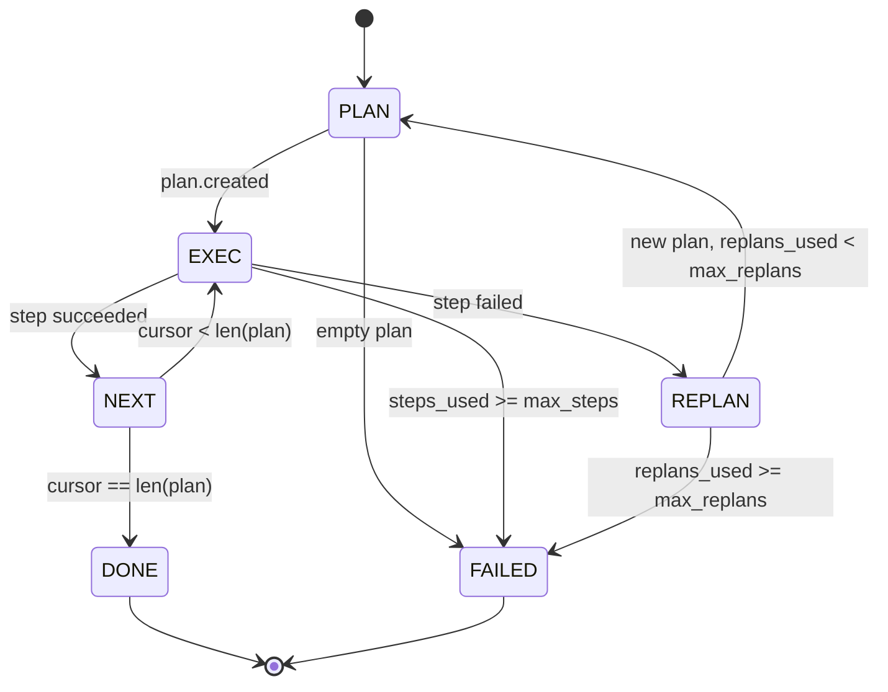

# Plan-Execute Control Flow

A plan that cannot survive a failure is a script. This module is the executor
that makes a plan survive: typed steps, a pure planner, a sequential state
machine, a visible diff on every revision, and two hard budgets.

The plan is data. The harness owns execution. On a tool failure, the executor
hands the error back to the planner from the failed cursor, records what
changed, and continues only while the step and replan allowances remain. The
deterministic planner and local tools make the whole mechanism runnable and
testable offline; the planner and dispatcher seams are where a real model and
real services plug in.

This is module `24-plan-execute-control-flow` of the track repository. It does
not import sibling modules.

## Contract at a glance

| Surface | Contract |
|---|---|
| `PlanExecuteAgent(planner, dispatcher, *, max_steps=12, max_replans=5)` | The only constructor |
| `PlanExecuteAgent.run(goal) -> SessionResult` | Runs one session synchronously |
| `Step(id, tool_name, args, expected_outcome, result=None, error=None)` | One planner-authored step and its eventual outcome |
| `Planner(goal, history, last_error) -> list[Step]` | Pure planning seam; `history` is the flat execution log |
| `Dispatcher.dispatch(tool_name, args) -> object` | Execution seam; raise on failure |
| `PlanDiff(removed, added, revised)` | Revision diff by step id |
| `SessionResult(status, reason, history, revisions, events)` | Terminal record |
| `max_steps` | Total executions, including failed attempts; default 12 |
| `max_replans` | Planner calls after the initial plan; default 5 |
| Failure reasons | `step_budget`, `replan_budget`, `no_plan` |
| Success reason | `goal_met` |
| Events | `plan.created`, `step.started`, `step.succeeded`, `step.failed`, `plan.diff`, `session.completed`, `session.failed` |

`status` is `"completed"` or `"failed"`. A completed session always has reason
`"goal_met"`; a failed session has one of the three budget/no-plan reasons.

## State machine



A failed step is executed exactly once and counts against `max_steps`. A refused
step is not executed, is not added to history, and emits no step event. The
replan ceiling is checked **before** calling the planner, so a session at the
ceiling never asks for another plan.

## Architecture

```text
main.py                       self-verifying offline demo, seven checks
bench.py                      local executor-throughput measurement
src/plan_execute/
  __init__.py                 public exports
  models.py                   Step, PlanDiff, SessionResult, diff/validation
  planner.py                  Planner protocol and deterministic replanner
  tools.py                    Dispatcher protocol, ToolError, local Toolbox
  agent.py                    PlanExecuteAgent state machine and budgets
tests/
  test_planner.py             plan shapes, marker routing, id validation, diff
  test_agent.py               success, replan chains, budgets, empty plans, events
```

```mermaid
flowchart TD
    goal[goal] --> planner[planner]
    planner -->|list[Step]| validate[validate_plan]
    validate -->|revision| exec[execute step]
    exec -->|success| next{more steps?}
    next -->|yes| exec
    next -->|no| completed[completed: goal_met]
    exec -->|exception| budget{replans_used < max_replans?}
    budget -->|no| failed[replan_budget]
    budget -->|yes| planner
    exec -->|steps_used >= max_steps| exhausted[step_budget]
```

### Typed data

`Step` copies its args on construction, so a caller mutating the original dict
cannot change an in-flight plan. `validate_plan` requires a real `Step` list
with strictly increasing ids and rejects already-executed steps. `SessionResult`
keeps the executed history (failed attempts included), every revision diff, and
the complete event stream.

### Planner

`deterministic_planner` is the lesson's stand-in for a model. It is a pure
function keyed on `last_error`:

| `last_error` | Plan |
|---|---|
| `None` | Four steps: inspect, draft notes, validate, publish |
| starts with `rate_limited` | Three steps: read cached notes, validate, publish |
| starts with `approval_required` | Two steps: queue for human approval, notify |
| anything else | `[]`, which the executor reports as `no_plan` |

Every revision restarts ids at 1. Identity across revisions is
`(revision, id)`; revision numbers are carried on events. The deterministic
planner ignores `history`, but the seam passes the full execution log so a model
planner can use prior results and errors.

### Plan diffs

On a failure, the old plan is the failed step plus the unexecuted tail. The new
plan is diffed against that remainder by id:

- `removed`: ids in the old remainder but not the new plan;
- `added`: ids in the new plan but not the old remainder;
- `revised`: ids present in both whose `tool_name` or `args` changed.

`expected_outcome` changes alone are not revisions. An identical plan produces
an empty diff and still consumes replan budget; there is no no-progress guard.
The `plan.diff` event is emitted before the revision's `plan.created`, so a
tracer sees the change and then the new plan.

The replan-once demo makes the semantics concrete:

```text
old remainder: 2 draft_notes, 3 validate, 4 publish
new revision:  1 read_cached, 2 validate, 3 publish
diff:          removed=[4], added=[1], revised=[2,3]
```

### Events

Events are deterministic dicts with no timestamps. The stable shapes are:

| Event | Fields |
|---|---|
| `plan.created` | `event`, `revision`, `count`, `steps` |
| `step.started` | `event`, `revision`, `step_id`, `tool_name`, `args`, `expected_outcome` |
| `step.succeeded` | started fields plus `result` |
| `step.failed` | started fields plus `error` |
| `plan.diff` | `event`, `revision`, `removed`, `added`, `revised`, `trigger_error` |
| `session.completed` / `session.failed` | `event`, `status`, `reason`, `steps_used`, `replans_used` |

`expected_outcome` is a planner statement, not an enforced success condition.
It rides in `plan.created`, `step.started`, and history so a tracer or a model
planner can see what the step was supposed to do.

## Quickstart

Requires Python 3.11+ and [uv](https://docs.astral.sh/uv/).

From a fresh clone of the track repository:

```bash
cd 24-plan-execute-control-flow
./verify.sh
.venv/bin/python main.py
.venv/bin/python bench.py
```

`verify.sh` installs the pinned development dependencies into `.venv` and
`.uv-cache` (both ignored), runs the 15 tests, runs strict mypy over the package
and the two scripts, then runs the demo. It is safe to run twice.

## Demo output

```text
{"scenario":"linear_success","status":"completed","reason":"goal_met","steps":4,"replans":0}
{"scenario":"replan_once","status":"completed","reason":"goal_met","steps":5,"replans":1}
{"scenario":"replan_twice","status":"completed","reason":"goal_met","steps":6,"replans":2}
{"scenario":"replan_exhaustion","status":"failed","reason":"replan_budget","steps":4,"replans":2}
{"scenario":"step_budget","status":"failed","reason":"step_budget","steps":3,"replans":1}
{"scenario":"no_plan","status":"failed","reason":"no_plan","steps":0,"replans":0}
{"scenario":"plan_diff","revision":2,"removed":[4],"added":[1],"revised":[2,3]}
demo verified: 7 scenarios
```

The first six lines are separate runs with fresh toolboxes. The final line is
read from the replan-once event stream; it is the format a downstream UI can
render as strikethroughs, highlights, and in-place edits.

## Testing strategy

There are 15 tests. Every test uses local deterministic planners and tools; no
sockets, subprocesses, sleeps, credentials, or model calls are involved.

`tests/test_planner.py` pins the four-step starting plan, both marker routes,
the empty fallback, id monotonicity, and the diff fields.

`tests/test_agent.py` covers the transition matrix:

- linear success and the exact event stream;
- a mid-plan failure that replans from the failed cursor and preserves the
  prior success in history;
- a second failure that replans with the first revision's error;
- replan exhaustion (`replan_budget`) with an empty second diff;
- step-budget exhaustion after failed attempts count;
- a zero step budget that refuses the first step;
- an empty initial plan (`no_plan`);
- an empty replan that still records a removal diff;
- `max_replans=0` that never calls the planner twice;
- an in-place revised step that runs with new args;
- invalid budgets and non-monotonic planner output that raise before dispatch.

The tests assert counts, tool-call order, history errors, diff contents, event
revision numbers, and planner-visible context, not just final statuses.

## Offline and real-provider boundary

**Offline:** all tests, the demo, and the benchmark use the deterministic
planner and the in-process `Toolbox`. There are no network calls, credentials,
model weights, or GPU work. `verify.sh` may download the pinned development
dependencies, but the executed scenarios are fully local.

**Simulated:** the release tools in `main.py` are deterministic fixtures. The
`Toolbox` is a compact local registry with required-key checks, not a full JSON
Schema registry and not a replacement for the sibling module's dispatcher.
Failures are injected as `ToolError` messages so the replanner can route on
`rate_limited` and `approval_required`.

**Optional real-provider mode (not shipped):** the capstone deliberately uses a
deterministic planner, so no API key, paid service, or network adapter is
included. The injection points are the two protocol seams:

```python
# Sketch only; the repository ships no network client.
def model_planner(
    goal: str, history: list[Step], last_error: str | None
) -> list[Step]:
    payload = client.plan(goal=goal, history=history, last_error=last_error)
    plan = [Step(**item) for item in payload["steps"]]
    validate_plan(plan)
    return plan
```

A real `Dispatcher` adapter wraps tool clients, owns timeouts and retries, and
raises an exception whose message is useful to the planner. Because the executor
seam is synchronous, an async dispatcher needs a sync adapter (for example, a
dedicated worker loop) or a future async port; this module does not mix both.

**GPU mode:** not applicable. The workload is control flow, not inference; there
is no local model or GPU path to toggle.

## Measured results

Measured locally with Python 3.14.10 on Linux x86_64 using
`.venv/bin/python bench.py`. The benchmark uses a no-op local toolbox and a
four-step plan, taking the median of 5 rounds × 1,000 executor runs. It measures
control-flow overhead, not tool latency or model latency.

| Path | Result |
|---|---:|
| Four-step plan, no-op tools | 12.15 µs/run |
| Four-step plan, no-op tools | 82,276 runs/s |

The demo's asserted observations:

| Scenario | Status / reason | Executions | Replans |
|---|---|---:|---:|
| `linear_success` | `completed / goal_met` | 4 | 0 |
| `replan_once` | `completed / goal_met` | 5 | 1 |
| `replan_twice` | `completed / goal_met` | 6 | 2 |
| `replan_exhaustion` | `failed / replan_budget` | 4 | 2 |
| `step_budget` | `failed / step_budget` | 3 | 1 |
| `no_plan` | `failed / no_plan` | 0 | 0 |

Run-to-run variation is expected. These are one local run, not a benchmark
suite, and they should not be compared with model-inference numbers.

## Design decisions

- **Plan as data, executor as control.** The planner returns typed steps; the
  executor decides whether to execute, replan, or fail. The planner never sees
  budget mechanics, retries, or timeouts.
- **A flat history plus one error.** On every replan the planner receives all
  executed steps (successes and failures) and only the most recent failure
  message. `expected_outcome` is present for a model planner to read; the
  deterministic planner does not need it.
- **Cursor diff, revision-local ids.** The comparison is the failed step plus
  the unexecuted tail, not the whole prior plan. Revision ids restart at 1, so
  events carry the revision number that disambiguates them.
- **Two budgets with different jobs.** `max_steps` bounds total tool work,
  including failed attempts. `max_replans` bounds repeated planner calls and
  fails faster than the step ceiling when a planner cannot make progress.
- **Check before acting.** The step budget is checked before dispatch; the
  replan budget is checked before the planner call. A refused operation leaves
  no partial history.
- **Copy steps into history.** Replacing a step with its executed copy keeps the
  current plan pristine for diffing and prevents history writes from mutating
  the planner's returned objects.
- **All tool exceptions are replannable; budgets are fatal.** The executor does
  not infer retry safety or a fatal tool class. A real dispatcher owns retry
  policy; the planner decides whether the message changes the route.
- **Graceful degradation still completes.** If the planner emits a fallback
  plan that executes successfully, the session is `completed / goal_met`; the
  history and expected outcomes show that the route changed.
- **No progress guard.** An identical plan is a legitimate (if poor) answer; it
  emits an empty diff and consumes replan budget. Hiding the no-op behind a
  special error would make the budget less transparent.
- **Deterministic events.** Plain dictionaries, stable keys, no timestamps, and
  no logging backend. A tracer can render them; tests can pin them exactly.
- **The local registry is intentionally small.** `Toolbox` checks registration
  and required keys only. The injected dispatcher is the place for full schema
  validation, timeouts, and idempotency.

## Limitations

- **Strictly sequential.** There are no parallel branches, gather steps, or
  dependency DAGs. Each step starts only after the previous one finishes.
- **In-memory and single-process.** Sessions are not persisted or resumable;
  history, revisions, and events live for one `run()` call.
- **Revision-local ids.** Step ids repeat across revisions. Consumers must pair
  them with the event revision (or the revision index) for a stable identity.
- **Synchronous dispatcher seam.** The async dispatcher from module 23 needs a
  sync adapter, or this module needs an async port. Do not mix both styles.
- **Malformed planner output raises.** Invalid ids, executed steps, or non-Step
  items raise `ValueError`; there is no automatic repair or model retry inside
  the executor.
- **No token, spend, wall-clock, or repeated-call budget.** Only step and replan
  counts are enforced; a real dispatcher must own provider-side limits.
- **Tool failures are not classified.** Any `Exception` is handed to the
  planner. A fatal domain error still spends step/replan budget instead of
  short-circuiting with a distinct reason.
- **No partial-plan caching.** After a failure the planner receives history but
  the executor does not suppress re-execution of steps the new plan repeats.
- **The fixture registry is not a schema engine.** `Toolbox` checks required
  keys only; extra arguments pass through.
- **Serialization is caller-owned.** `SessionResult.to_dict()` copies events
  and steps, but arbitrary tool results may not be JSON-serializable.
- **No real provider or GPU path.** The deterministic planner is the shipped
  planner; the README documents the seam but deliberately adds no network code.
- **Benchmarks are one local run.** The numbers measure executor overhead only.

## References

These sources informed the design and were read while planning. The code is
original; no source code was copied.

1. AI Engineering From Scratch, "Plan-Execute Control Flow" capstone
   specification — step shape, planner signature, state machine, plan diff,
   budgets, and result shape.
   <https://aiengineeringfromscratch.com/learn/capstone-projects/plan-execute-control-flow>
2. Lei Wang et al., "Plan-and-Solve Prompting: Improving Zero-Shot
   Chain-of-Thought Reasoning by Large Language Models," arXiv:2305.04091 —
   separating a plan from carrying out its subtasks.
   <https://arxiv.org/abs/2305.04091>
3. LangChain, "Plan-and-Execute Agents" — the planner/executor split, replanning
   after execution, and the cost/latency case for not consulting the large model
   after every action.
   <https://www.langchain.com/blog/planning-agents>
4. Anthropic, "Building effective agents" — start with simple composable
   patterns, show planning steps explicitly, and give agents stopping
   conditions such as a maximum number of iterations.
   <https://www.anthropic.com/engineering/building-effective-agents>
5. AWS Well-Architected Agentic AI Lens, "AGENTPERF02-BP01 Design efficient
   reasoning pipelines" — per-task iteration caps, bounded failure recovery,
   observable termination causes, and graceful degradation before a target is
   exceeded.
   <https://docs.aws.amazon.com/wellarchitected/latest/agentic-ai-lens/agentperf02-bp01.html>

## License

MIT © 2026 Pedro Monteiro. See `LICENSE`.
