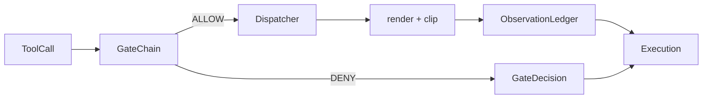

# Verification Gates and the Observation Budget

An agent harness without a verification layer is a wish in a trenchcoat. This module is
the deterministic layer between a model's tool call and tool execution: an ordered gate
chain, an append-only observation ledger, exact output clipping, and content-free refusal
records. A denied call never reaches the dispatcher and never spends budget. Every
allowed call writes exactly one ledger row for what the model was actually shown.

The three-turn demo makes the mechanism concrete: two allowed observations fill a
200-token budget, the second output is clipped to the 61 tokens that remain, and the
third call is refused by the budget gate with a refusal count. All tests, the demo, and
the benchmark run offline against deterministic in-process fixtures. The implementation
is Python stdlib only and does not import sibling modules.

The capstone lesson sketches one `main.py`. This track implementation splits the same
mechanism into a typed package with `main.py` as the runnable demo, matching the layout of
modules 20–24.

## Contract at a glance

| Surface | Contract |
|---|---|
| `estimate_tokens(text) -> int` | The lesson heuristic: `len(text) // 4`; no rounding up. |
| `clip_text(text, token_limit) -> tuple[str, bool]` | Head-and-tail clipping with `TRUNCATION_MARKER`; the result never exceeds `token_limit`. |
| `ToolCall(turn, name, arguments, observed_turn=None)` | Frozen wire shape; JSON-serializable argument mapping; `turn >= 1`; `0 <= observed_turn <= turn`. |
| `Observation(turn, tool, tokens, truncated=False)` | One immutable ledger row. |
| `GateDecision(allow, reason, gate_name)` | `permit(gate_name)` and `deny(gate_name, reason)`; `to_dict()` is the ingestible record. |
| `ObservationLedger()` | `record`, `cumulative`, `per_tool`, `last_turn`, `observations`, `visible`, `masked`, `len`. |
| `GateContext(ledger)` | The read-only state passed to every gate. |
| `VerificationGate` | Protocol with `name: str` and `evaluate(call, ctx) -> GateDecision`. |
| `GateChain(gates)` | `evaluate` returns the first deny or a chain-level allow; `review` also returns every evaluated decision. |
| `GatedToolExecutor(chain, dispatcher, *, refusal_limit=3)` | Requires exactly one `BudgetGate`; derives the clipping ceiling from its `limit`. |
| `Dispatcher` | `Callable[[ToolCall], object]`; results must be `str` or JSON-serializable. |
| `Execution` | `status` is `allowed`, `truncated`, or `denied`; `refusal_message`; content-free `to_dict()`. |

The exact gate names are `whitelist`, `regex`, `recency`, `budget`, and `tool_budget`.
The chain's all-pass decision is labeled `chain`, and the executor's post-closure
rejection is labeled `harness`. The exact deny reasons are:

| Gate | Reason |
|---|---|
| `whitelist` | `tool '<name>' is not in the allowlist` |
| `regex` | `argument matches blocked pattern: <rule reason>` |
| `recency` | `observation from turn <observed> is outside the <window>-turn window at turn <turn>` |
| `budget` | `observation budget exhausted: <used>/<limit> tokens` |
| `tool_budget` | `per-tool observation budget exhausted for '<tool>': <used>/<limit> tokens` |
| `harness` | `refusal limit reached: <count>/<limit>` |

## Architecture

```text
main.py                       three-turn demo, gate probes, 29 assertions
bench.py                      local gate, executor, and clipping measurements
verify.sh                     frozen install, tests, strict mypy, demo
src/verification_gates/
  __init__.py                 public exports
  models.py                   ToolCall, Observation, GateDecision
  tokens.py                   estimate_tokens, clip_text, marker
  ledger.py                   ObservationLedger and recency views
  gates.py                    GateContext, protocol, five concrete gates
  chain.py                    GateChain and ChainResult
  executor.py                 GatedToolExecutor and Execution
tests/
  test_models.py              wire shapes and decision invariants
  test_tokens.py              heuristic and clipping boundaries
  test_ledger.py              totals, monotonic rows, window views
  test_gates.py               each gate in isolation and configuration errors
  test_chain.py               trails, short-circuiting, label validation
  test_executor.py            allow/deny/clip/closure and the three-turn loop
```



The chain is an ordered list, not a sorted set. The intended order is whitelist, regex,
recency, global budget, per-tool budget: cheap structural claims first, the final policy
ceiling last. Both `cumulative()` and `per_tool()` are O(1) here, so the lesson's
"budget reads the whole ledger" cost argument applies to a scanning implementation; this
implementation preserves the order by blast radius and for predictable traces.

## Semantics

### Two-phase observation budget

The budget gate is the pre-dispatch half. It denies when
`ledger.cumulative() >= limit`; exactly at the ceiling denies. The executor is the
post-dispatch half: after an allowed call, it computes the remaining tokens and clips the
rendered result to that remainder. The ledger records the clipped token count, so the
cumulative total never passes the ceiling.

This is deliberate. A result's size is unknown before dispatch, so a pre-dispatch gate
cannot predict it. The two halves together give an exact ceiling without guessing. A
result that would pass the ceiling is clipped to the remainder; every later call is
refused.

### Ledger and recency windows

A window of `N` includes the current turn and the previous `N - 1` turns. The oldest
visible turn is `current_turn - window + 1`. At turn 3 with window 2, turns 2 and 3 are
visible and turn 1 is masked. `visible()` and `masked()` return metadata rows; the caller
owns the message store and decides how to render or mask the actual text.

Masking does not refund budget. The ledger measures tokens the model has already read,
not tokens currently present in the window. A compaction system might reclaim budget;
this lesson deliberately does not.

### Recency is a grounding contract

The gate cannot infer which prior observation a call relied on from arbitrary arguments.
`ToolCall.observed_turn` is therefore an optional, caller-stamped claim. When it is set,
`RecencyGate` denies a call whose grounding observation is outside the visible window:
the result would land in a context that no longer contains its premise. A call with
`observed_turn=None` passes the gate; the README states the limit rather than guessing.

### Clipping

`clip_text` keeps the beginning and the end, inserting
`"\n...[truncated]...\n"` in the middle. Both ends matter: the beginning often contains
the hit, and the end often contains the failure. The structural `truncated` flag remains
authoritative when the budget is too small to fit the marker.

### Refusal accounting

A chain denial increments the executor's refusal count and returns the full evaluation
trail. The call is not dispatched and no ledger row is written. When the count reaches
`refusal_limit`, the executor closes; later calls receive a `harness` deny before gate
evaluation, without changing the count and without dispatching. The demo sets
`refusal_limit=1` so the budget refusal ends the session.

### Content-free records

`Execution.to_dict()` contains the tool name, turn, status, decision, gate evaluations,
observation metadata, original/omitted token counts, refusal count, and closure flag.
It does not contain arguments or output text. This mirrors the OpenTelemetry GenAI
convention of treating tool arguments and results as opt-in content. The caller owns the
message store: `Execution.refusal_message` and `Execution.observation` are what the loop
appends.

## Quickstart

Requires Python 3.11+ and [uv](https://docs.astral.sh/uv/).

From a fresh clone of the track repository:

```bash
cd 25-verification-gates-observation-budget
./verify.sh
.venv/bin/python main.py
.venv/bin/python bench.py
```

`verify.sh` installs the pinned development dependencies into `.venv` and `.uv-cache`
(both ignored), runs the 57 tests, runs strict mypy over the package and both scripts, and
runs the demo. It is safe to run twice. The first run may download the pinned packages;
the tests, demo, and benchmark themselves make no network calls.

## Demo output

```text
{"arguments":{"path":"src/app.py"},"event":"call","observed_turn":0,"tool":"read_file","turn":1}
{"allow":true,"event":"gate","gate":"whitelist","reason":null,"turn":1}
{"allow":true,"event":"gate","gate":"regex","reason":null,"turn":1}
{"allow":true,"event":"gate","gate":"recency","reason":null,"turn":1}
{"allow":true,"event":"gate","gate":"budget","reason":null,"turn":1}
{"allow":true,"event":"gate","gate":"tool_budget","reason":null,"turn":1}
{"cumulative":139,"event":"observation","tokens":139,"tool":"read_file","truncated":false,"turn":1}
{"arguments":{"path":"src/app.py","pattern":"value_"},"event":"call","observed_turn":1,"tool":"grep","turn":2}
{"allow":true,"event":"gate","gate":"whitelist","reason":null,"turn":2}
{"allow":true,"event":"gate","gate":"regex","reason":null,"turn":2}
{"allow":true,"event":"gate","gate":"recency","reason":null,"turn":2}
{"allow":true,"event":"gate","gate":"budget","reason":null,"turn":2}
{"allow":true,"event":"gate","gate":"tool_budget","reason":null,"turn":2}
{"cumulative":200,"event":"observation","tokens":61,"tool":"grep","truncated":true,"turn":2}
{"arguments":{"path":"README.md"},"event":"call","observed_turn":2,"tool":"read_file","turn":3}
{"allow":true,"event":"gate","gate":"whitelist","reason":null,"turn":3}
{"allow":true,"event":"gate","gate":"regex","reason":null,"turn":3}
{"allow":true,"event":"gate","gate":"recency","reason":null,"turn":3}
{"allow":false,"event":"gate","gate":"budget","reason":"observation budget exhausted: 200/200 tokens","turn":3}
{"closed":true,"event":"denied","gate":"budget","message":"tool call 'read_file' denied by budget: observation budget exhausted: 200/200 tokens","reason":"observation budget exhausted: 200/200 tokens","refusals":1,"tool":"read_file","turn":3}
{"event":"context","masked":[{"tokens":139,"tool":"read_file","truncated":false,"turn":1}],"masked_tokens":139,"turn":3,"visible":[{"tokens":61,"tool":"grep","truncated":true,"turn":2}],"visible_tokens":61,"window":2}
{"allow":false,"evaluations":["whitelist"],"event":"probe","gate":"whitelist","name":"whitelist","reason":"tool 'delete_repo' is not in the allowlist","tool":"delete_repo"}
{"allow":false,"evaluations":["whitelist","regex"],"event":"probe","gate":"regex","name":"regex_shell","reason":"argument matches blocked pattern: destructive shell command","tool":"shell"}
{"allow":false,"evaluations":["whitelist","regex"],"event":"probe","gate":"regex","name":"regex_private_ip","reason":"argument matches blocked pattern: private network address","tool":"http_get"}
{"allow":false,"evaluations":["whitelist","regex","recency"],"event":"probe","gate":"recency","name":"recency","reason":"observation from turn 1 is outside the 2-turn window at turn 6","tool":"read_file"}
{"allow":false,"evaluations":["whitelist","regex","recency","budget","tool_budget"],"event":"probe","gate":"tool_budget","name":"per_tool_budget","reason":"per-tool observation budget exhausted for 'read_file': 180/180 tokens","tool":"read_file"}
{"dispatched":0,"event":"probe","first_closed":false,"first_gate":"whitelist","name":"refusal_limit","refusals":2,"second_closed":true,"third_evaluations":0,"third_gate":"harness"}
{"allowed":2,"closed":true,"denied":1,"event":"summary","observed_tokens":200,"omitted_tokens":86,"original_tokens":286,"refusals":1,"turns":3}
demo verified: 29 checks
```

| Turn | Call | Status | Original tokens | Observed tokens | Cumulative |
|---:|---|---|---:|---:|---:|
| 1 | `read_file` | `allowed` | 139 | 139 | 139 |
| 2 | `grep` | `truncated` | 147 | 61 | 200 |
| 3 | `read_file` | `denied` by `budget` | 0 | 0 | 200 |

Turn 2 originally produced 147 tokens; only the 61 remaining tokens were retained, and
86 were omitted. Turn 3 was never dispatched. The masked view at turn 3 contains only
turn 2; turn 1 is outside the two-turn window. The probes exercise the other gates and
the refusal threshold.

## Testing strategy

There are 57 tests, all offline and deterministic. The suite is grouped by contract:

| File | Tests | Focus |
|---|---:|---|
| `tests/test_models.py` | 13 | argument copying and JSON validation, turn rules, decision invariants, observation rules |
| `tests/test_tokens.py` | 9 | `len // 4`, zero/tiny budgets, marker reservation, head+tail preservation |
| `tests/test_ledger.py` | 6 | cumulative and per-tool totals, monotonic turns, empty ledger, window boundaries |
| `tests/test_gates.py` | 9 | whitelist fail-closed, nested regex matches, recency boundaries, budget ceilings, per-tool isolation |
| `tests/test_chain.py` | 5 | all-pass trail, first-deny short-circuit with spies, duplicate/mislabeled rejection |
| `tests/test_executor.py` | 15 | allow/deny, exact clipping, closure, non-monotonic rejection, serialization errors, three-turn loop |

The tests use local callables, small string fixtures, and an in-process dispatcher. They
open no sockets, spawn no subprocesses, read no credentials, and call no model. The
end-to-end test asserts two allowed observations, one clipped observation, one budget
refusal, the exact cumulative total, and the dispatcher call list.

## Offline and real-provider boundary

**Offline:** all 57 tests, the 29-check demo, and the benchmark run locally with Python's
standard library. There are no model calls, credentials, network requests, subprocesses,
or GPU work. `verify.sh` may download the pinned development dependencies on its first
run; the executed scenarios are fully local.

**Simulated:** the tool handlers in `main.py` return small deterministic strings. The
gate decisions, clipping, ledger, refusal accounting, and telemetry record are real. The
`shell`, `http_get`, and `delete_repo` handlers are never invoked on the allowed path;
they exist so an accidentally allowed probe would have a deterministic result instead of
a process or network call. No shell command is executed and no URL is fetched.

**Optional real-provider mode (not shipped):** the module deliberately has no API client,
paid service, or network adapter. The seams are explicit:

```python
# Sketch only; the repository ships no network client.
def service_dispatcher(call: ToolCall) -> object:
    return service.execute(call.name, dict(call.arguments))
    # Return a str or JSON-serializable object. Raise on transport failure;
    # the caller owns retries, timeouts, and provider limits (module 23).

# The model router that produces calls should stamp the grounding turn:
call = ToolCall(turn=7, name="write_file", arguments=args, observed_turn=6)
```

A production tokenizer replaces `estimate_tokens` and `clip_text` together. The current
char-based clipper is the inverse of the `len // 4` heuristic; a tokenizer-aware clipper
must preserve the same guarantee that the observed text never exceeds the remaining
budget. The global ceiling remains the `BudgetGate.limit`; the executor reads it from the
chain. **GPU mode:** not applicable; this module performs no inference.

## Measured results

Measured locally with Python 3.14.10 on Linux x86_64 using
`.venv/bin/python bench.py`. Each metric is the median of 5 rounds: 100,000 chain reviews,
5,000 full executions, and 100,000 clipping calls per round. These are gate and plumbing
costs, not model or tool latency, and run-to-run variation is expected.

| Path | Result |
|---|---:|
| Four-gate chain review, allow | 5.516 µs/call (181,281 calls/s) |
| Gated execution, 10-token observation | 10.304 µs/call (97,054 calls/s) |
| `clip_text`, 4 KiB to 100 tokens | 0.375 µs/call (2,664,469 calls/s) |

The demo's asserted observations:

| Scenario | Status / reason | Observed tokens | Cumulative |
|---|---|---:|---:|
| Turn 1 `read_file` | `allowed` | 139 | 139 |
| Turn 2 `grep` | `truncated` | 61 | 200 |
| Turn 3 `read_file` | `denied / budget` | 0 | 200 |

Original output across the two allowed calls was 286 tokens; 86 were omitted. The demo
performed 29 assertions and exited zero. These are one local run, not a benchmark suite.

## Design decisions

- **Gates sit outside the model.** Every decision is a deterministic function of the
  call, the ledger, and the gate configuration. No model judges another model's call.
- **The whitelist fails closed.** Unknown tools are denied; an empty allowlist denies
  everything. OWASP's agent guidance is explicit about least privilege and failing closed
  for unknown tools.
- **One budget gate is the source of truth.** The executor refuses to construct unless
  the chain contains exactly one `BudgetGate`, then derives its clipping ceiling from
  that gate. The policy and the view limit cannot drift apart.
- **Two-phase budget enforcement.** The gate refuses at the ceiling; the executor clips
  the one result that reaches it. The ledger records observed tokens, so the ceiling is
  exact even though output size is unknown before dispatch.
- **Recency is an explicit contract.** `observed_turn` makes the grounding claim visible.
  The gate enforces the claim; it does not infer intent from arbitrary arguments.
- **Masking does not refund.** The budget measures attention already spent, not the
  current window's size.
- **Head and tail survive clipping.** A single marker in the middle keeps the beginning
  and the end, where hits and failures usually live. The structural flag is authoritative
  for tiny budgets.
- **Content-free telemetry.** `Execution.to_dict()` carries decisions and token counts,
  not prompts or tool content. Content capture is a separate opt-in concern.
- **Configuration errors fail at construction.** Bad windows, limits, regexes, duplicate
  gate names, and missing budget gates raise before a call is dispatched.
- **Mislabeled decisions are rejected.** A gate cannot silently emit a decision under
  another gate's name; the trace stays trustworthy.
- **Turns are monotonic.** The executor rejects a call whose turn precedes the latest
  observation before dispatch, avoiding a tool side effect followed by a ledger failure.
- **The caller owns the message store.** This layer returns a refusal message and
  observation metadata; the loop decides what to append and when to abort.

## Limitations

- **The token counter is a heuristic.** `len(text) // 4` under-counts short strings (a
  three-character result costs zero) and is only a crude fit for code or mixed Unicode.
  Replace it with a real tokenizer and a tokenizer-aware clipper in production.
- **Clipping is character-based.** It preserves a token ceiling only under the same
  heuristic; it is not tokenizer-aware.
- **Recency requires a claim.** Calls with `observed_turn=None` pass; a router that never
  stamps grounding turns gets no recency protection.
- **Per-tool limits are pre-dispatch only.** The final result can push a tool past its
  per-tool limit; only the global budget is clipped exactly. The per-tool gate is a
  policy check, not a second view ceiling.
- **Regex is a denylist.** Aliases, encoding tricks, and shell syntax can bypass a
  pattern. The whitelist is the primary control; regexes are defense in depth.
- **Masking is a view, not a refund.** Old observations keep spending budget.
- **No message-store persistence.** The caller owns the store; this module does not
  persist, reload, or compact a session.
- **Single-process and synchronous.** The ledger and executor are not thread-safe or
  resumable. The dispatcher seam is synchronous.
- **A non-serializable result raises after the tool ran.** The result is not observed and
  no row is written; dispatchers must return `str` or JSON-serializable values.
- **Dispatcher exceptions propagate.** There is no retry, timeout, or error-result
  mapping here; a real dispatcher owns those policies.
- **No OpenTelemetry exporter.** The decision record is designed to be ingested, but the
  module does not depend on an OTel SDK or emit spans.
- **No provider or GPU path.** The demo uses deterministic fixtures; inference is out of
  scope.
- **The benchmark is one local run.** It measures gate overhead, not model latency, and
  the numbers should not be compared across machines.

## References

These sources informed the design and were read while planning. The code is original;
no source code was copied.

1. AI Engineering From Scratch, "Capstone Lesson 25: Verification Gates and the
   Observation Budget" — the gate protocol, gate set, ledger, budget, and three-turn
   demo contract.
   <https://aiengineeringfromscratch.com/learn/capstone-projects/verification-gates-observation-budget>
2. Anthropic, "Effective context engineering for AI agents" — context as a finite
   attention budget, context rot, tool-result clearing, and just-in-time retrieval.
   <https://www.anthropic.com/research/effective-context-engineering-for-ai-agents>
3. JetBrains Research, "Cutting Through the Noise: Smarter Context Management for
   LLM-Powered Agents" — observation masking with a rolling window; their study reported
   more than 50% cost reduction versus an unmanaged context, which is their result, not
   a measurement of this module.
   <https://blog.jetbrains.com/research/2025/12/efficient-context-management/>
4. OWASP, "AI Agent Security Cheat Sheet" — least privilege for tools, allowlists, fail
   closed for unknown tools, human oversight for high-impact actions, and audit trails.
   <https://cheatsheetseries.owasp.org/cheatsheets/AI_Agent_Security_Cheat_Sheet.html>
5. OpenTelemetry, "Semantic conventions for generative AI tool execution" —
   `gen_ai.operation.name=execute_tool`, `gen_ai.tool.name`, and opt-in capture of tool
   arguments and results.
   <https://github.com/open-telemetry/semantic-conventions-genai/blob/main/docs/gen-ai/execute-tool.md>

## License

MIT © 2026 Pedro Monteiro. See `LICENSE`.
