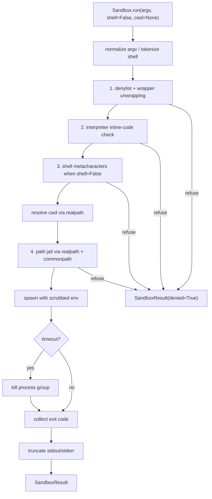

# Sandbox Runner with Denylist and Path Jail

A deterministic, stdlib-only subprocess runner for coding-agent tool calls. It sits
after the verification gate: the gate decides whether a call may run; this runner
decides how it runs, what it may touch, how long it gets, and how much output is
kept.

The sandbox has four refusal axes before any child process exists:

1. **Executable name** — dangerous commands are denied by basename, so
   `/bin/rm`, `rm.exe`, and `rm` are the same refusal.
2. **argv structure** — interpreter inline-code flags (`python -c`,
   `node -e`, `bash -c`, ...) are denied; known command wrappers are unwrapped
   first so `env rm` and `env python3 -c ...` do not hide the target.
3. **Shell metacharacters** — `;`, `|`, `&`, `>`, `<`, backticks, `$(` and
   newlines are refused when the caller did not explicitly request a shell.
4. **Path jail** — every path-like argument is resolved with
   `os.path.realpath`, then checked with `os.path.commonpath` against the
   project root. `../`, absolute escapes, sibling-prefix attacks, and symlinks
   pointing outside are refused.

Only after all axes pass does the runner spawn a process, with a scrubbed
environment, captured output, a wall-clock timeout, and process-group kill on
POSIX. Captured streams are truncated to a byte ceiling with a visible marker.

This is a **development-time guardrail, not an OS security boundary**.
See [Security scope and limitations](#security-scope-and-limitations) before
using it with untrusted code.

## Architecture



All four refusal checks run before `Popen`, so a denied call never creates a
process.

### Result contract

`SandboxResult` is frozen, validated, and JSON-serializable through
`to_dict()`:

| Field | Meaning |
| --- | --- |
| `exit_code` | Child exit code; `-100` denied; `-101` timed out |
| `stdout`, `stderr` | Captured text (`utf-8`, replacement characters on invalid bytes) |
| `truncated` | At least one stream was clipped |
| `timed_out` | Wall-clock timeout fired and the process group was killed |
| `denied` | A refusal axis rejected the call before spawn |
| `reason` | Human-readable refusal or timeout reason; `None` otherwise |
| `duration_ms` | Wall-clock duration of the sandbox call, including refusals |

Successful and failed child commands keep their real exit codes. Timeouts and
refusals get sentinel codes so downstream observability can ingest one shape
without parsing stderr.

### Layout

```text
26-sandbox-runner-denylist/
├── main.py                       # 13-call demo: legal + adversarial outcomes
├── bench.py                      # local refusal / spawn / truncation measurements
├── pyproject.toml                # stdlib runtime; pinned dev tools
├── uv.lock                       # reproducible dev environment
├── verify.sh                     # install, test, typecheck, run demo
├── src/sandbox_runner/
│   ├── models.py                 # config, result, truncation, defaults
│   └── sandbox.py                # normalization, refusal axes, spawn, timeout
└── tests/                        # 114 deterministic tests
```

## Quickstart

Requirements: Python 3.11+ and `uv`. From the **repository root**:

```bash
cd 26-sandbox-runner-denylist
./verify.sh
```

`verify.sh` is safe to run repeatedly. It installs the two pinned dev
dependencies into the ignored local `.venv` (using the ignored `.uv-cache`),
runs the test suite, runs strict mypy over the source, and executes the demo.
The first run needs access to the Python package index for `pytest` and
`mypy`; after that the local uv cache is sufficient.

Run the pieces directly:

```bash
.venv/bin/python main.py                 # JSON table of 13 calls + assertion summary
.venv/bin/python bench.py                # local measurements
.venv/bin/python -m pytest -q            # 114 tests
.venv/bin/python -m mypy src main.py bench.py
```

Use the runner from another local script (the package is intentionally not
installed; add `src` to the path):

```python
from pathlib import Path
import sys

sys.path.insert(0, "src")
from sandbox_runner import Sandbox, SandboxConfig

root = Path("/path/to/project").resolve()
sandbox = Sandbox(
    SandboxConfig(
        project_root=root,
        max_output_bytes=64 * 1024,
        timeout_seconds=5.0,
    )
)
result = sandbox.run(["python3", "check.py", "src/main.py"])
print(result.to_dict())
```

A denied call returns `exit_code == -100`, `denied == True`, and a reason. A
timeout returns `-101`, `timed_out == True`, and keeps any partial output that
was captured before the kill.

## Policy details

### Denylist and wrappers

The default denylist covers destructive or privilege-changing commands such as
`rm`, `sudo`, `su`, `chmod`, `chown`, `dd`, `mkfs*`, `mount`, `shutdown`,
`systemctl`, and `busybox`. Matching uses the normalized basename, so path
aliases collapse to the same name. The list is configurable through
`SandboxConfig.denylist`.

Known wrappers that execute another command are unwrapped before the denylist
and interpreter checks: `env`, `nohup`, `nice`, `timeout`, `stdbuf`, `setsid`,
`command`, and `exec`. `env -S` / `--split-string` is refused because the
wrapped command is hidden inside one string that the argv inspector cannot
safely prove. Wrapper targets are still path-checked as arguments, so an
absolute executable outside the project root is refused even though it is the
inner command.

### Interpreters

An interpreter is denied when any later token looks like inline code: `-c`,
`-e`, `-m`, `-p`, `-r`, a bare `-`, or long forms such as `--eval`. This is
intentionally conservative; for example, a script argument beginning with
`--config` also matches the `-c` shape and is refused. Versioned interpreter
names such as `python3.14` are recognized.

### Shell mode

The default is `shell=False`. A raw string argument is rejected unless
`shell=True`; a sequence is passed directly to `Popen` with no shell. When
`shell=True` is explicitly requested, shell syntax is allowed, but the
denylist and interpreter checks still run against parsed command positions.
Shell mode is the highest-risk mode because static argv inspection cannot see
runtime expansion. Prefer `shell=False`.

### Path jail

A candidate path is resolved with `os.path.realpath` and compared to the
resolved project root using `os.path.commonpath`. This catches:

- `../` and `sub/../../` traversal;
- absolute paths outside the root;
- sibling-prefix attacks (`/tmp/root-evil` vs `/tmp/root`);
- symlinks inside the root that point outside;
- `cwd` overrides outside the root.

`~` and `~/...` map to the project root; other users' homes are refused.
`os.path.commonpath` is used instead of character-prefix matching because a
common string prefix is not a safe path boundary. Paths that do not exist yet
are still checked after realpath, so an escape cannot become legal by being
absent. A missing path inside the root is allowed and fails through the child's
normal exit code.

### Environment, timeout, and truncation

The child receives only a small allowlist of environment variables (`PATH`,
locale, terminal, and platform essentials). `HOME`, `TMPDIR`, `TMP`, `TEMP`, and
`PWD` are set to the project root or its resolved cwd. Non-allowlisted parent
variables, including `PYTHONPATH`, are dropped.

On POSIX the child starts in a new session; a timeout kills the process group,
not just the direct child, then drains pipes with a short bounded wait. The
result marks `timed_out` and keeps captured partial output. On Windows only the
direct child is killed.

Truncation keeps the beginning and end of each stream and inserts
`\n...[truncated]...\n`, so an error at the end of a noisy log is not silently
lost. `max_output_bytes` applies separately to stdout and stderr, after the
command completes.

## What runs offline

Everything in this module runs offline after the development dependencies are
installed:

- no model provider, API key, token, GPU, cloud sandbox, or external service;
- no network calls in the tests or demo;
- tests spawn only local Python scripts and local shell builtins/tools;
- fixtures are created in `tmp_path` / temporary directories;
- no secrets are read or written; the environment test uses a fake variable
  value and verifies that it is scrubbed.

The only network access is the first `uv sync` fetching the pinned `pytest` and
`mypy` wheels. `verify.sh` itself never pushes, publishes, or calls a remote
service.

### Optional real-provider / GPU mode

There is no real-provider or GPU mode, and none is simulated. A sandbox runner
does not need a model to be useful: the harness supplies the already-gated tool
call. If this module is later wired into a live agent, keep `Sandbox.run` as the
execution step and layer OS isolation underneath it. The local determinism is a
feature for tests and evaluation.

## Measured results

Measured locally with `bench.py` on this workstation:

- 12th Gen Intel Core i5-1235U, 12 threads
- Linux 7.3.5 (CachyOS), x86_64
- CPython 3.14.10
- median of 5 rounds; 50,000 denylist/path calls and 100,000 truncation calls
  per round, 20 spawns per round

| Measurement | Result |
| --- | ---: |
| Denylist refusal, full `run()` path | 4.22 µs/call (~237k calls/s) |
| Path-jail refusal, full `run()` path | 19.38 µs/call (~52k calls/s) |
| Clean Python child, spawn through result | 10.21 ms/call (~98 calls/s) |
| Truncate 8 KiB to 256 bytes | 0.29 µs/call (~3.4M calls/s) |

The pure refusal checks are cheap relative to process creation. These numbers
measure this implementation on one machine; they are not a comparison with
containers or microVMs, and they should not be extrapolated to a security
guarantee.

`main.py` runs 13 calls covering success, nonzero exit, denylist refusal,
interpreter refusal, path escape, metacharacter refusal, timeout, truncation,
shell mode, stderr capture, and missing paths. It exits zero only if all
assertions pass.

## Tests

114 tests, all deterministic and local:

- `test_models.py` — config/result invariants, JSON shape, truncation edges;
- `test_denylist.py` — names, path aliases, wrapper unwrapping, malformed argv;
- `test_interpreter.py` — inline-code shapes, versioned interpreters, wrappers;
- `test_shell.py` — metacharacters, shell opt-in, compound shell commands;
- `test_path_jail.py` — traversal, sibling prefixes, symlinks, flags, cwd, `~`;
- `test_execution.py` — capture, exit codes, cwd, env scrub, truncation limits;
- `test_timeout.py` — timeout sentinel, partial output, process-group kill;
- `test_demo.py` — demo exit status and one JSON result per call.

Tests avoid timing-sensitive assertions except the timeout tests, which use
sub-second limits and a bounded `/proc` poll for the process-group proof.
Where platform features are unavailable (symlinks, POSIX execute bits, `/proc`),
the test skips rather than weakening the assertion.

## Design decisions

- **`Popen` instead of `subprocess.run`.** The lesson's requirements include
  process-group kill and partial-output capture. `Popen` with
  `start_new_session=True` on POSIX makes that explicit; `subprocess.run` would
  hide the pid and process-group handling.
- **Sequence argv by default.** This follows the platform's supported
  argument-separation API and avoids shell interpolation. Raw strings require
  `shell=True` explicitly.
- **Refuse before spawn.** Denylist, interpreter, metacharacter, and path checks
  are pure and ordered. A denial has empty output and no side effects.
- **Resolve paths with `realpath` + `commonpath`.** Prefix checks are a classic
  path-jail bug; the common-path API returns a real path boundary and rejects
  mixed absolute/relative inputs.
- **Unwrap known wrappers.** An argv inspector that only examines `argv[0]` is
  trivially bypassed by `env python3 -c ...`. The runner follows the known
  wrapper chain and refuses uninspectable `env -S`.
- **Scrub the environment.** The agent should not inherit unrelated parent
  secrets; `HOME` and temp paths are redirected into the project.
- **Cap after capture, per stream, with a marker.** This preserves a useful
  tail for debugging while bounding what downstream observability ingests. The
  known memory risk of buffering before clipping is documented below.
- **Keep sentinel codes and structured fields.** Downstream lessons should not
  parse stderr or infer timeout from a negative PID-style return code.

## Security scope and limitations

**Not an OS sandbox.** There are no namespaces, cgroups, seccomp filters,
gVisor, microVMs, capability drops, or mount isolation. Anything the child can
do, it can do with the runner user's privileges. A determined attacker with
code execution can escape this guardrail. It stops common agent mistakes and
makes refusals loud; it is not a containment boundary.

Specific limits:

- The path jail inspects **argv**, not syscalls. An allowed script can open
  any path itself. `shell=True` allows runtime expansion (`$VAR`, globbing,
  command substitution) that static token checks cannot follow.
- Wrapper unwrapping covers eight common wrappers. Other executor shapes —
  `xargs`, `find -exec`, custom launchers, package-manager scripts, or a
  binary that re-executes commands — are not traced. The denylist and
  interpreter rules are pattern guards, not a complete policy.
- Denylist matching is by basename. A renamed copy of a dangerous binary, or a
  script that implements the same effect, is not detected.
- Path checks are time-of-check/time-of-use checks. A process with write
  access to the project tree could swap a symlink between `realpath` and the
  child's open. Mounting the project read-only or using OS isolation removes
  this class of race.
- Output is buffered by `communicate()` before truncation. A child that emits
  unbounded output can consume memory until the timeout kills it. The cap is
  not a streaming memory cap.
- `max_output_bytes` is per stream, so total captured text can be roughly twice
  the configured value. Decoding replaces invalid UTF-8, which can change the
  encoded size slightly.
- Timeout enforcement is wall-clock and cooperative on POSIX process-group
  kill; process creation itself cannot be interrupted, and Windows only kills
  the direct child. A child that escapes the process group is not caught.
- The runner does not restrict network access, filesystem writes outside argv
  paths, device access, or resource usage beyond the wall-clock timeout.
- Shell mode is inherently weaker than argv mode; it exists for explicit
  builtins and pipelines, not as the safe default.
- The environment scrub is not a secret vault. Files inside the project, and
  values the child creates or finds, are still readable.

For production, layer this with OS isolation: an unprivileged container or
microVM, a read-only project mount plus a writable scratch directory, dropped
Linux capabilities, `no-new-privileges`, seccomp, memory/CPU/pid limits, a
network namespace or proxy allowlist, and secret injection outside the sandbox.
The local guardrail remains useful for deterministic evaluation and for
refusing obvious mistakes early, but it is not a replacement for those layers.

## References

Sources actually used while designing and validating this module:

1. AI Engineering from Scratch — Capstone Lesson 26, *Sandbox Runner with
   Denylist and Path Jail*:
   https://aiengineeringfromscratch.com/learn/capstone-projects/sandbox-runner-denylist
2. Python documentation — `subprocess`, including sequence arguments, timeout
   behavior, and the warning to read security considerations before
   `shell=True`:
   https://docs.python.org/3/library/subprocess.html#security-considerations
3. Python documentation — `os.path.commonpath`, including the explicit warning
   that character-wise `commonprefix` is not safe for path prefixes:
   https://docs.python.org/3/library/os.path.html#os.path.commonpath
4. OWASP Cheat Sheet Series — *OS Command Injection Defense*, covering
   parameterization, allowlist validation, and argument injection:
   https://cheatsheetseries.owasp.org/cheatsheets/OS_Command_Injection_Defense_Cheat_Sheet.html
5. Claude Agent SDK documentation — *Securely deploying AI agents*, covering
   least privilege, defense in depth, containers, gVisor, VMs, and credential
   boundaries:
   https://code.claude.com/docs/en/agent-sdk/secure-deployment

## License

MIT © 2026 Pedro Monteiro. See [LICENSE](LICENSE).
