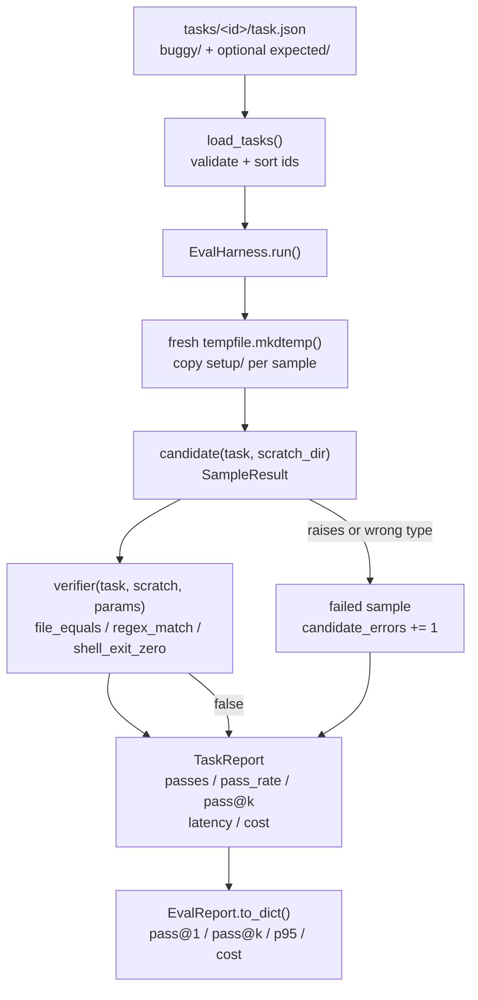

# Eval Harness with Fixture Tasks

A deterministic evaluation harness for coding agents. It loads a directory of fixture
tasks, runs each task `k` times in an isolated scratch directory, scores every sample with
a deterministic verifier, and aggregates pass@1, pass@k, mean/p95 latency, and cost into a
JSON report.

The harness is deliberately candidate-agnostic: a candidate is any callable
`(FixtureTask, scratch_dir) -> SampleResult`. The bundled reference candidate is a literal
patch applier, so the demo is fast, offline, and reproducible. A real LLM adapter uses the
same boundary.

This module addresses three benchmark failure modes directly:

- **Unverified pass.** The agent's `success_self_reported` flag is recorded but never used
  for scoring. Only a deterministic verifier decides pass/fail.
- **Undetected regression.** Every task is sampled every run; the report includes per-task
  passes, raw sample counts, and a self-reported pass rate next to the verified one.
- **Per-task drift.** Tasks load in sorted id order with a strict schema. A renamed or
  removed fixture changes the report's task list and totals.

No network access, API key, GPU, or external service is required.

## Architecture



For each task and each of the `k` samples the harness:

1. Creates a new scratch directory with `tempfile.mkdtemp()`.
2. Copies the task's `setup.copy` tree into it.
3. Calls the candidate with the task and the scratch path.
4. Calls the task's verifier only when the candidate returned a valid `SampleResult`.
5. Records the verifier's boolean, candidate-reported latency/cost, and deletes the
   scratch directory in a `finally` block.

The verifier runs even when the candidate's self-report is `False`; the self-report is not
a gate. If the candidate raises or returns the wrong type, the sample is failed without
running the verifier.

### Layout

```text
27-eval-harness-fixture-tasks/
├── main.py                       # demo: k=5 reference run, JSON report
├── pyproject.toml                # stdlib runtime; pinned dev tools
├── uv.lock                       # reproducible dev environment
├── verify.sh                     # install, test, typecheck, run demo
├── src/eval_harness/
│   ├── models.py                 # dataclasses, pass@k, p95, path safety
│   ├── fixtures.py               # strict task.json loader
│   ├── verifiers.py              # registry + three built-ins + argv runner
│   ├── harness.py                # sampling loop + aggregation
│   ├── reference.py              # apply_known_fixes
│   └── __init__.py
├── tasks/                        # five fixture tasks
└── tests/                        # 57 deterministic tests
```

## Quickstart

Requirements: Python 3.11+ and [uv](https://docs.astral.sh/uv/). From the repository root:

```bash
cd 27-eval-harness-fixture-tasks
./verify.sh
```

`verify.sh` is idempotent. It installs the pinned dev tools into the ignored local
`.venv` (using the ignored `.uv-cache`), runs the tests, runs strict mypy, and runs the
demo. The first invocation needs package-index access for `pytest` and `mypy`; subsequent
runs use the local uv cache. The runtime itself is stdlib-only.

Run the pieces directly:

```bash
.venv/bin/python -m pytest -q                  # tests
.venv/bin/python -m mypy src main.py            # strict typecheck
.venv/bin/python main.py                        # JSON EvalReport
python3 main.py                                 # same demo, no .venv needed
```

The demo exits zero and prints only the report JSON. Assertions inside `main.py` fail the
process if the reference candidate does not reach pass@1 = 1.0 over the five fixtures.

## Fixture task format

Each task is a directory whose name equals its id:

```text
tasks/factorial-missing-return/
├── task.json
├── buggy/
│   └── factorial.py
└── expected/
    └── factorial.py
```

`task.json`:

```json
{
  "id": "factorial-missing-return",
  "goal": "factorial(n) computes the product but never returns it.",
  "setup": {"copy": "buggy"},
  "verifier": {
    "name": "file_equals",
    "params": {
      "path": "factorial.py",
      "expected": "expected/factorial.py"
    }
  }
}
```

The loader enforces:

- exactly `id`, `goal`, `setup`, and `verifier` at the top level;
- lower-case kebab-case ids that equal the directory name;
- `setup` exactly `{"copy": "<relative-directory>"}`, resolved inside the task directory;
- `verifier` exactly `{"name": "...", "params": {...}}`;
- absolute paths, `..`, and symlink escapes are rejected with `FixtureError`;
- every task directory in the tasks root must contain a valid `task.json`;
- an empty tasks root is an error, not a vacuous 0-task pass.

`goal` is the prompt a real adapter would pass to an agent. The reference harness does not
parse it.

### Bundled fixtures

| Task | Bug | Verifier |
| --- | --- | --- |
| `fizzbuzz-off-by-one` | `range(1, n)` drops `n`; a provided check script asserts behavior | `shell_exit_zero` |
| `factorial-missing-return` | computes the product but omits `return result` | `file_equals` |
| `error-message-typo` | raises `"invalid portt"` instead of `"invalid port"` | `regex_match` |
| `empty-function-body` | `slugify` is `pass`; a provided check script asserts behavior | `shell_exit_zero` |
| `linked-list-off-by-one` | traversal stops before the tail | `file_equals` |

The expected files are the buggy sources with the reference patch applied. The reference
candidate applies literal edits and never reads `expected/`, so the demo is not a copy of
the answer key.

## Verifiers

`VerifierRegistry` maps names to callables
`(FixtureTask, scratch: Path, params: Mapping[str, object]) -> bool`. The default registry
contains exactly three:

| Verifier | Params | Pass condition |
| --- | --- | --- |
| `file_equals` | `path`, `expected` | named scratch file text exactly equals expected task artifact |
| `regex_match` | `path`, `pattern` | Python `re.search` finds the pattern in the named scratch file |
| `shell_exit_zero` | `command`, optional `timeout_seconds` | argv command exits 0 |

Unknown verifier names are rejected before any candidate sample runs. Unknown params and
wrong param types are `FixtureError`s, not candidate failures, because a broken fixture
must not be scored as a bad agent. Missing candidate output files fail the verifier
normally; missing expected files are fixture errors.

`file_equals` compares exactly, including the trailing newline. Use `regex_match` or
`shell_exit_zero` when multiple implementations are acceptable.

### shell_exit_zero safety

`command` is an argv array, never a shell string. `{python}` is substituted with
`sys.executable`; `["{python}", "-m", "pytest", "..."]` is the intended style. The runner:

- uses `shell=False` and a non-empty argv;
- rejects common destructive executable basenames (`rm`, `sudo`, `dd`, `sh`, ...);
- pins `cwd` to the scratch directory;
- scrubs the environment to `PATH`, `HOME=scratch`, empty `PYTHONPATH`, UTF-8 IO, and no
  bytecode files;
- enforces a timeout and treats timeout/nonzero exit as a verifier failure.

This is a development guardrail, not an OS security boundary. Fixture commands are trusted
repository data, and candidate code runs with the user's privileges.

## Metrics

For one task with `k` samples and `c` verified passes, `p = c / k`.

- **pass@1** is the macro mean of per-task `p`. With equal `k` this equals total passes /
  total samples.
- **pass@k** is the macro mean of `1 - (1 - p)^k`. It is the plug-in estimator mandated by
  the spec, computed per task rather than from the aggregate pass@1 (which would hide
  hard/easy task mix).
- **raw counts** are reported per task: `passes`, `k`, `pass_rate`, `pass_at_k`, and
  `candidate_errors`.
- **self-reported pass rate** is the fraction of all samples whose candidate self-report was
  true. Comparing it to pass@1 exposes unverified passes.
- **mean latency** is the mean candidate-reported `latency_ms` across samples. If a candidate
  raises, the harness substitutes measured wall-clock time for that sample.
- **p95 latency** uses nearest-rank selection over every sample (no interpolation).
- **cost** is candidate-reported `cost_units`; the report includes mean and total. The unit
  is intentionally adapter-defined (tokens, USD, or a normalized unit). The reference
  patch applier truthfully reports `0.0`.

Pass@k at `n = k` is biased low; it is not the unbiased HumanEval estimator. Report raw
counts with it, and for publishable pass@k draw `n > k` samples and use the unbiased
estimator described in the Codex paper. This harness intentionally implements the
specified plug-in metric and makes the limitation explicit.

## Offline and real-provider boundary

Everything in `verify.sh` and the demo runs offline: fixtures are local files, verifiers are
stdlib checks, and the shell verifier executes local Python scripts. Tests make no network
calls and use no secrets.

To evaluate a real agent, implement the candidate protocol. The adapter owns model calls,
patch application, timing, and accounting:

```python
from time import perf_counter

from eval_harness import SampleResult


def provider_candidate(task, scratch_dir):
    started = perf_counter()
    response = client.run_agent(goal=task.goal, workspace=scratch_dir)
    return SampleResult(
        success_self_reported=response.ok,
        latency_ms=(perf_counter() - started) * 1000.0,
        cost_units=response.cost_usd,
        edits=tuple(response.edited_files),
    )
```

Hook it up with `EvalHarness(TASKS_DIR, provider_candidate, k=5).run()`. The harness then
re-runs the deterministic verifiers against whatever the adapter wrote. No provider SDK is
imported by this repository, and no provider mode is enabled by default; the offline core
is complete on its own.

## Measured locally

Gate: `./verify.sh` exited 0; a second run also exited 0.

| Measurement | Result |
| --- | --- |
| Test suite | 57 passed |
| Strict mypy | Success: no issues found in 7 source files |
| Demo configuration | 5 tasks × k=5 = 25 samples |
| Demo pass@1 | 1.0 |
| Demo pass@5 | 1.0 |
| Demo self-reported pass rate | 1.0 |
| Demo mean latency | ≈0.10 ms |
| Demo p95 latency | ≈0.15 ms |
| Demo mean cost | 0.0 |
| Demo candidate errors | 0 |
| Environment | Linux x86_64, Python 3.14.10, uv 0.13.9 |

Timing is a single local run of the reference patch applier and varies by machine. It
measures the candidate's file edits, not setup or verifier subprocess time; it is not a
model-latency benchmark. Cost is zero because the reference uses no model tokens. The
non-zero cost aggregation path is covered by synthetic candidates in the tests.

## Limitations

- **In-process candidate.** The harness does not sandbox candidate code. A real untrusted
  agent needs an OS/container boundary; the scratch directory only isolates fixture state.
- **Self-reported telemetry.** Latency and cost are trusted from `SampleResult`. Real
  adapters must measure them honestly. There is no provider-side cross-check.
- **Shell guardrail.** `shell_exit_zero` denies common destructive executables and avoids a
  shell, but it is not a security boundary.
- **Exact text checks.** `file_equals` rejects whitespace differences, including a missing
  final newline. That is intentional for narrow repair tasks; use the other verifiers for
  implementation freedom.
- **Plug-in pass@k.** With `n = k` samples it understates the unbiased estimate; README and
  report expose raw counts rather than hiding this.
- **Sequential and in-memory.** There is no parallel execution, result caching, or per-sample
  log persistence. A fixture-content digest is not computed, so the report shows task ids
  and counts but not content drift.
- **No real provider mode.** The adapter boundary is documented and demonstrated in the
  snippet above, but network/secret code is intentionally absent.

## References

- [Capstone Lesson 27: Eval Harness with Fixture Tasks](https://aiengineeringfromscratch.com/learn/capstone-projects/eval-harness-fixture-tasks) — task format, verifier shapes, pass@k requirement.
- Chen et al., [Evaluating Large Language Models Trained on Code](https://arxiv.org/abs/2107.03374) — pass@k definition, unbiased estimator, and the bias of `1 - (1 - p)^k`.
- [SWE-bench Evaluation Guide](https://www.swebench.com/SWE-bench/guides/evaluation/) — apply a patch, run repository tests, and count resolved instances in a reproducible harness.
- [Inspect: Tasks](https://inspect.aisi.org.uk/tasks) — separation of dataset, solver, scorer, setup/cleanup, and run limits in an eval framework.
