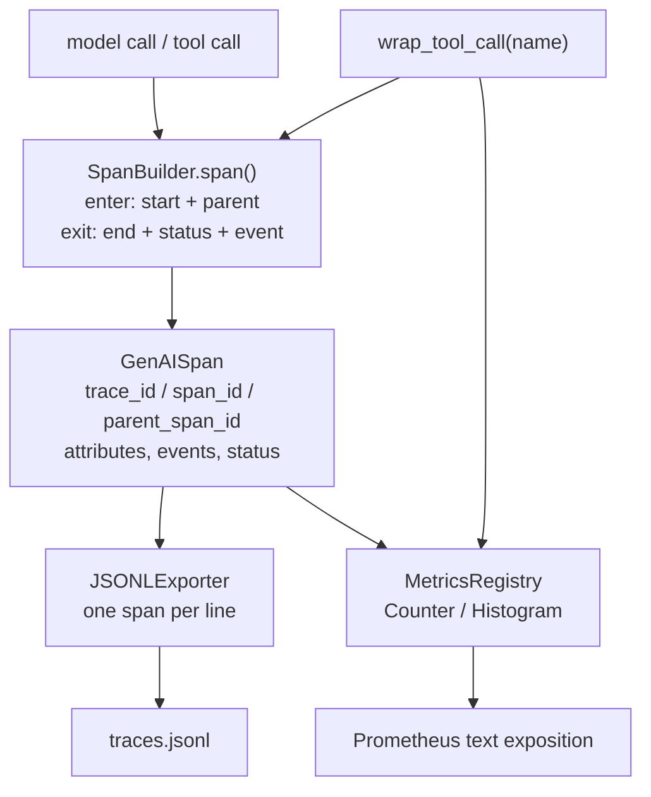

# Observability with OTel GenAI Spans and Prometheus Metrics

A stdlib-only observability layer for an agent harness. Every model call, tool call, and
verification decision can produce a structured span; spans are exported as JSON Lines and
tool metrics are exposed in Prometheus text format. The demo runs offline and exits zero on
a clean workstation.

The module addresses the three observability failure modes from the capstone lesson:

- **Missing trace.** A failed turn leaves only a chat log. Spans record the operation name,
  duration, status, parent/child links, token usage, and the exception that ended it.
- **Non-standard trace.** Ad-hoc field names cannot be read by an OTel backend. Spans use
  the `gen_ai.*` attribute keys from the OpenTelemetry GenAI conventions, with both the
  lesson-era `gen_ai.system` and the current `gen_ai.provider.name` provider keys.
- **Unaggregated metric.** A single slow trace does not answer "p95 of `read_file` calls".
  Labeled counters and latency histograms are kept next to the traces and serialized in the
  Prometheus pull format.

## Architecture



`SpanBuilder` owns one trace id (one agent invocation) and a per-builder current-span
context. A span opened inside another span inherits its trace and links to its parent.
Entering a span also activates its builder, so a decorated tool called inside a model span is
instrumented without extra wiring. `JSONLExporter` appends a single JSON line per finalized
span. `MetricsRegistry` stores counters and raw histogram samples per label set;
`prometheus_exposition()` computes cumulative buckets on demand.

### OTel shape

- `trace_id`: 32 lowercase hex characters (16 bytes), from `uuid4().hex`, all-zero rejected.
- `span_id`: 16 lowercase hex characters (8 bytes), same source and guard.
- `parent_span_id`: parent span id or `null`.
- `start_unix_nano` / `end_unix_nano`: Unix epoch nanoseconds; duration is the difference.
- `status`: `UNSET` while open, `OK` on normal exit, `ERROR` when the body raised.
- `status_message`: exception text for errors.
- `events`: exception events carry `exception.type`, `exception.message`,
  `exception.stacktrace`; failures also set the stable `error.type` attribute.
- `attributes`: a plain JSON object. Canonical model attributes are constants in
  `src/otel_observability/span.py`.

The exported JSON object has exactly these ten keys; there is no resource block, no OTLP
resource, and no wrapper object.

## Quickstart

Requirements: Python 3.11+ and [uv](https://docs.astral.sh/uv/). From a fresh clone:

```bash
cd 28-observability-otel-traces
./verify.sh
.venv/bin/python main.py
```

`verify.sh` installs the pinned dev dependencies into `.venv` and `.uv-cache` (both
git-ignored), runs the test suite, type-checks with strict mypy, and runs the demo. It is
safe to run repeatedly. The runtime code uses only the standard library, so the demo also
runs without installing anything:

```bash
python3 main.py
```

Expected output:

- `Wrote 4 spans ...`: one `gen_ai.chat` span and three `gen_ai.tool.execution` children
  (`read_file` twice, `write_file` once). The second `read_file` is a missing-file call:
  its span is `ERROR`, while the outer chat span stays `OK` because the demo catches the
  error.
- A three-span sample with duration and trace prefix.
- Prometheus exposition containing `tools_called_total{tool="read_file"} 2`,
  `tools_called_total{tool="write_file"} 1`, and `tool_latency_ms` histogram buckets with
  `le="+Inf"`, `_sum`, and `_count`.
- The temporary directory is removed before `main()` returns; no `traces.jsonl` is left in
  the working directory.

### Layout

```text
28-observability-otel-traces/
├── main.py                       # deterministic demo + public API re-exports
├── pyproject.toml                # stdlib runtime; pinned dev tools
├── uv.lock                       # reproducible dev environment
├── verify.sh                     # install, test, typecheck, demo (idempotent)
├── src/otel_observability/
│   ├── span.py                   # GenAISpan, SpanBuilder, context propagation
│   ├── exporter.py               # JSONLExporter
│   ├── metrics.py                # Counter, Histogram, registry, exposition
│   ├── instrumentation.py        # wrap_tool_call and implicit activation
│   └── __init__.py               # public exports
└── tests/                        # 36 deterministic tests, no network
```

## Design decisions

**Hand-rolled instead of `opentelemetry-sdk`.** The SDK brings a batching exporter thread,
resource detection, and a large dependency surface. This module teaches the wire shape
directly. In production the same attributes go into the real SDK, which supplies OTLP,
batching, sampling, and resource metadata.

**JSONL as the offline OTLP stand-in.** One self-contained JSON object per line is
streamable, grep-able, and importable without a collector. It is not OTLP JSON and has no
resource/scope wrapper; a production exporter should translate the same `GenAISpan` fields
to OTLP.

**Legacy and current provider keys.** The lesson requires `gen_ai.system`. The current
GenAI conventions renamed it to `gen_ai.provider.name` in v1.37 (2025) and moved the whole
GenAI namespace to `open-telemetry/semantic-conventions-genai`; neither has a tagged GenAI
release yet. Model spans therefore emit both keys. Token keys use the current names
(`gen_ai.usage.input_tokens` / `output_tokens`, not `prompt_tokens` /
`completion_tokens`).

**Lesson span names.** The span names are exactly the lesson's `gen_ai.chat` and
`gen_ai.tool.execution`. Current OTel display-name guidance is `chat {model}` and
`execute_tool {tool}`; `gen_ai.operation.name` uses the canonical values `chat` and
`execute_tool`.

**Metrics names are harness-level.** `tools_called_total` and `tool_latency_ms` are the
lesson's metric names. They are not the OTel GenAI metric names
(`gen_ai.execute_tool.duration` and the token usage counters); mapping live telemetry to
those is left to production instrumentation.

**Fixed latency buckets.** 5, 10, 25, 50, 100, 250, 500, 1000, 2500, 5000, 10000 ms,
followed by `+Inf`. This is the lesson's trimmed OTel SDK default set. Histograms retain
raw samples; bucket counts are computed at exposition time.

**Exporter failures never break the harness.** `JSONLExporter.export()` catches all
ordinary exceptions, increments `errors`, records `last_error`, writes a diagnostic to
stderr, and returns `False`. The span still closes and the agent continues.

**Tool instrumentation is safe.** `wrap_tool_call(name)` records
`gen_ai.tool.execution` with `gen_ai.operation.name="execute_tool"`,
`gen_ai.tool.name`, and a synthesized `gen_ai.tool.call.id` (`call_` + 16 hex). Outside an
active builder/span it is a plain passthrough. Metrics record both successful and failed
calls; exceptions propagate unchanged and mark the span `ERROR`.

**Single-writer metrics.** Counters and histograms are not internally locked. The harness
is sequential; the exporter itself is locked so concurrent writers cannot interleave JSON
lines. If tools are executed concurrently, add synchronization around registry mutation.

## Offline boundary and real providers

Everything in this module runs offline: no API key, network call, GPU, or external
service is required by the demo or the tests.

The simulated parts are the model response, the token counts (128 input / 64 output), the
model id (`gpt-4o-mini`), and the tool delays (6 ms read, 30 ms write, real sleeps used to
exercise histogram buckets). Files are actually read and written in a temporary directory.
There is no real-provider mode and no GPU mode; GPU acceleration is not applicable to
telemetry code.

To plug in a real provider, keep the span/metrics boundary and replace the fixed chat block
in `main.py` with a real SDK call: set `gen_ai.system` and `gen_ai.provider.name` from the
provider, `gen_ai.request.model` from the request, and `gen_ai.response.model`,
`gen_ai.response.id`, `gen_ai.usage.input_tokens`, and `gen_ai.usage.output_tokens` from the
response. The decorated tool calls and the `SpanBuilder`/`MetricsRegistry` wiring stay the
same. For a backend, either import the JSONL into a collector/filelog pipeline or replace
`JSONLExporter` with the OTel SDK's OTLP exporter over the same span records.

## Measured locally

Measured on Linux x64 with Python 3.14.10, using the committed fixture and a single run;
timings vary by machine.

- `./verify.sh`: 36 tests passed; strict mypy reported `Success: no issues found in 6 source files`.
- Demo: 4 spans; `tools_called_total{tool="read_file"} 2`,
  `tools_called_total{tool="write_file"} 1`; `read_file` histogram count 2 with both
  observations at or below the 10 ms bucket; `write_file` count 1 at or below 50 ms.
- One demo run: 43.58 ms `gen_ai.chat`, 6.09 ms / 6.21 ms `read_file` calls, 30.25 ms
  `write_file`; process wall time 0.091 s.
- One repeated `./verify.sh` run after setup: 0.601 s wall time; it reuses
  `.venv`/`.uv-cache` and completes without reinstalling.

## Limitations

- No OTLP/gRPC export, batching, retry queue, sampling, or file rotation.
- Histogram samples are retained forever in memory; a long process grows without bound.
- Fixed millisecond buckets are not suitable for arbitrary metric units.
- Metrics are single-writer; only JSONL appends are lock-protected.
- The JSONL schema is this project's shape, not OTLP JSON and not a Jaeger/Honeycomb import
  format.
- Only a subset of GenAI conventions is emitted: no input/output message content, no
  finish reasons, no tool arguments/results, no resource attributes.
- GenAI semantic conventions remain Development status and have no tagged GenAI release;
  `gen_ai.system` is emitted only for compatibility with the lesson and older consumers.
- Timestamps are wall-clock Unix nanoseconds; durations are derived, not monotonic-clock
  spans.

## References

- [Capstone Lesson 28: Observability with OTel GenAI Spans and Prometheus Metrics](https://aiengineeringfromscratch.com/learn/capstone-projects/observability-otel-traces) — task specification and required behavior.
- [OpenTelemetry GenAI semantic conventions](https://github.com/open-telemetry/semantic-conventions-genai) — current `gen_ai.*` attributes, spans, and error/status guidance.
- [Prometheus exposition formats](https://prometheus.io/docs/instrumenting/exposition_formats/) — text format, cumulative histograms, `+Inf`, `_sum`/`_count`, HELP/TYPE, escaping.
- [W3C Trace Context](https://www.w3.org/TR/trace-context/) — 32-hex trace id and 16-hex span id, all-zero rejection.
- [OpenTelemetry GenAI semantic conventions: November 2026 status](https://john-hodge.com/blog/opentelemetry-genai-semantic-conventions/) — rename timeline (`gen_ai.system` → `gen_ai.provider.name` in v1.37), move to the dedicated repository, and lack of a tagged GenAI release.
