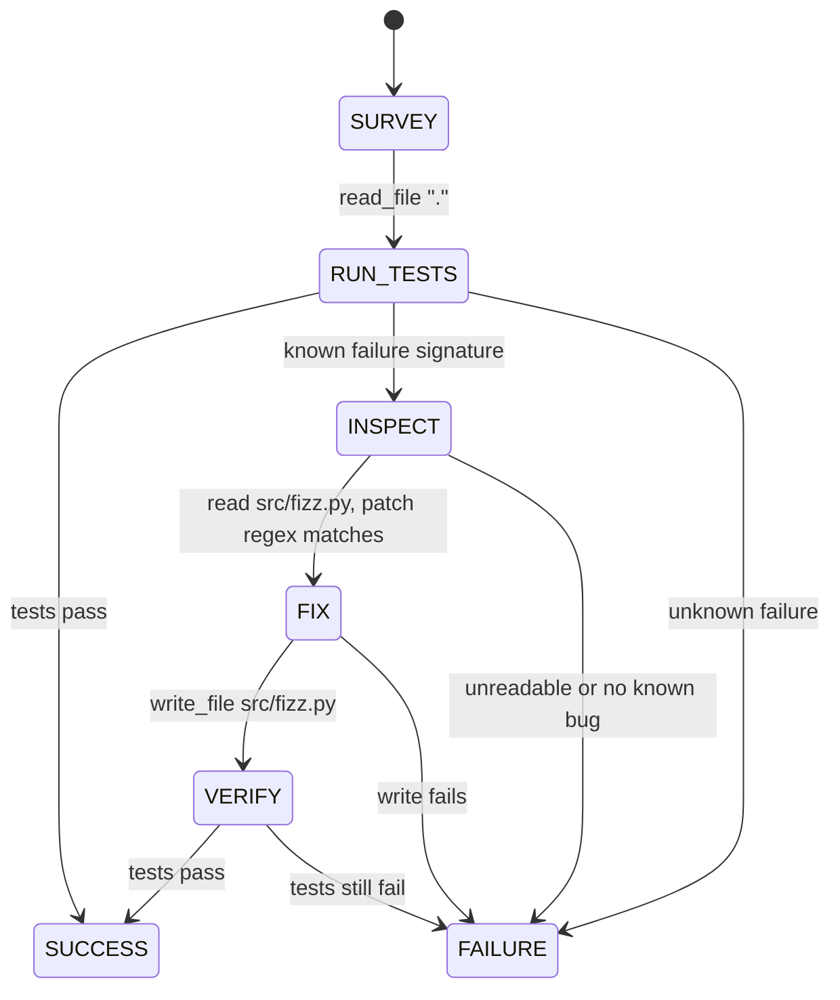
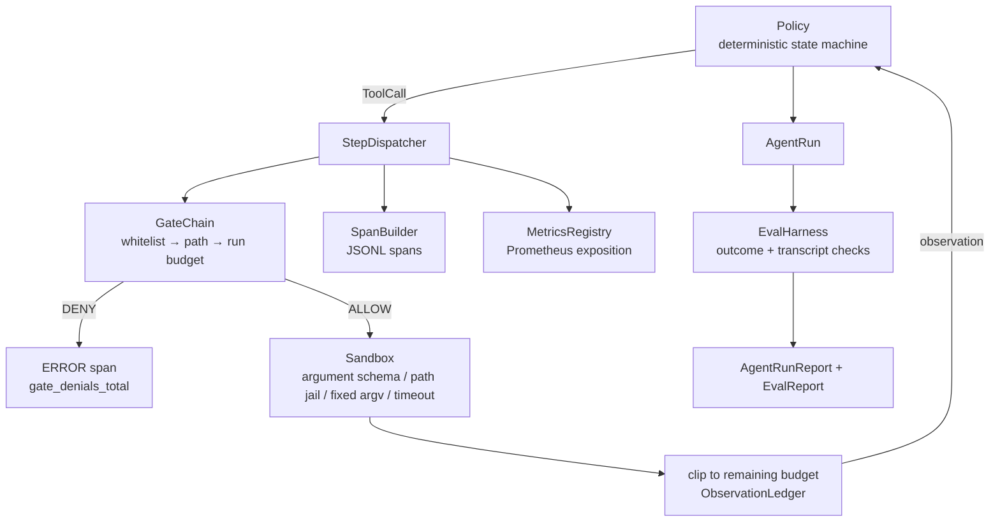

# End-to-End Coding Agent on the Harness

A deterministic coding agent that fixes a real off-by-one bug in a two-directory
Python project by composing five harness primitives into one loop: a gate chain,
a sandbox, an observation ledger, OTel-shaped spans, and Prometheus metrics. The
policy is a five-state machine, not an LLM, so every step, token, span, and metric
is reproducible. The harness contract is model-shaped: replacing the policy with a
provider-backed adapter leaves the rest of the system unchanged.

This module is the integration capstone for the track's verification-gate,
sandbox, eval-harness, and observability lessons. It imports no sibling module.

## Overview

The agent does six things in order: survey the project, run the tests, inspect
the failing source, write the fix, rerun the tests, and stop. Five tool calls do
the work; the sixth action is the halt. Every call passes through the gate chain
and the sandbox, every result is clipped into the observation budget and appended
to the ledger, every step gets a span, and an independent eval harness scores the
outcome.

The fixture bug is a missing `+ 1` in `fixture_repo/src/fizz.py`:

```python
for number in range(1, n):       # buggy
for number in range(1, n + 1):   # corrected
```

The failing unittest suite prints the stable message
`fizzbuzz(15) must end with 'FizzBuzz'`. The policy recognizes that signature and
the exact source line, reads the file, writes the corrected source, and verifies.
The expected tree is used only by the eval harness; it is never copied into the
agent's scratch directory.

### State machine



## Architecture



There is exactly one dispatch path. `StepDispatcher.dispatch()` evaluates the
gate chain, calls the sandbox, clips and records the observation, increments the
metrics, and emits the span. No second code path can call a tool, which is why
the gate decision, the sandbox result, the ledger, the metric, and the span cannot
disagree about whether a call happened.

### Layers

| Path | Responsibility |
| --- | --- |
| `src/end_to_end_agent/models.py` | `ToolCall`, `GateDecision`, `RunLimits` |
| `src/end_to_end_agent/tooling.py` | Single source of truth for tool arguments, path policy, tree listing |
| `src/end_to_end_agent/ledger.py` | Token heuristic, head/tail clipping, `ObservationLedger` |
| `src/end_to_end_agent/gates.py` | `GateChain`, whitelist, path, and run-budget gates |
| `src/end_to_end_agent/sandbox.py` | Fixed-command test runner, path-jailed file tools, timeout/kill |
| `src/end_to_end_agent/policy.py` | `Policy` protocol and `CodingAgentPolicy` |
| `src/end_to_end_agent/span.py` | `GenAISpan`, `SpanBuilder`, JSONL export |
| `src/end_to_end_agent/metrics.py` | Counters, histograms, Prometheus exposition |
| `src/end_to_end_agent/harness.py` | `Repo`, `StepDispatcher`, `AgentRun`, `AgentRunReport` |
| `src/end_to_end_agent/evaluation.py` | `EvalHarness`, `EvalReport` |
| `main.py` | Demo entry point and public re-exports |

The lesson asks for the primitives to ship in `main.py`. This repository's track
convention is a `src/` package plus a thin demo, so the implementations live in
`src/end_to_end_agent/` and `main.py` re-exports every required name
(`GateChain`, `Sandbox`, `ObservationLedger`, `SpanBuilder`, `MetricsRegistry`,
`CodingAgentPolicy`, `Repo`, `AgentRun`). Nothing imports a sibling module.

### Invariants

- Tool names are limited to `read_file`, `run_tests`, and `write_file`.
- Writes are limited to `src/`; the expected tree is unreadable to the agent;
  the bundled tests are read-only through the gate and the sandbox.
- The global step budget is 12; the observation budget is 2000 tokens. The
  budget gate denies before an attempt, and the ledger clipping guarantees the
  recorded total never exceeds the budget.
- `tools_called_total` increments exactly once per gate-allowed call, in the
  dispatcher. Gate denials increment `gate_denials_total` instead.
- Each attempt, including a denied one, produces exactly one tool span. The run
  produces one parent span.
- The eval harness never trusts the policy's self-report: it checks the scratch
  source against `fixture_repo/expected/src/fizz.py`, checks the tests are
  untouched, reruns the transcript invariants, and inspects the exposition.

## Quickstart

Requirements: Python 3.11+ and [uv](https://docs.astral.sh/uv/). From a fresh
clone:

```bash
cd agent-harness-from-scratch/29-end-to-end-coding-task-demo
./verify.sh
.venv/bin/python main.py
```

`verify.sh` installs the pinned dev dependencies into the git-ignored `.venv/`
and `.uv-cache/`, runs the suite, type-checks the package and demo with strict
mypy, and runs the demo. It is safe to run twice. The runtime itself is
stdlib-only:

```bash
python3 main.py
```

Expected demo output (values vary by machine):

```text
Coding agent demo: fix the fizzbuzz off-by-one
Policy: SUCCESS; 5 steps; 815/2000 observation tokens
[step 1] SURVEY     read_file . -> ok ...
[step 2] RUN_TESTS  run_tests -> tests_failed ...
[step 3] INSPECT    read_file src/fizz.py -> ok ...
[step 4] FIX        write_file src/fizz.py -> ok ...
[step 5] VERIFY     run_tests -> ok ...
Result: SUCCESS in 5 steps; 6 spans; 0 gate denials; eval pass_at_1=1.0
Eval report: PASS (9/9 checks)
...
tools_called_total{tool="read_file"} 2
tools_called_total{tool="run_tests"} 2
tools_called_total{tool="write_file"} 1
# TYPE tool_latency_ms histogram
```

The temporary trace is printed by path and removed with the demo's scratch
directory. To retain it, call the API directly from the module root with the
package on the path:

```bash
PYTHONPATH=src .venv/bin/python - <<'PY'
from pathlib import Path
from end_to_end_agent import AgentRun, Repo

with Repo() as repo:
    report = AgentRun(repo, trace_path=Path("traces.jsonl")).run()
    print(report.step_count, report.observation_tokens, report.eval_report)
PY
```

### What the demo asserts

1. The policy solved the fixture in fewer than 12 steps.
2. The observation budget was never exceeded.
3. Zero gate denials fired on legal tools.
4. Every step has a corresponding span in the JSONL trace.
5. The exposition contains `tools_called_total{tool="read_file"}` and the
   `tool_latency_ms` histogram.

The test suite reasserts those and adds negative cases for the budget, path,
sandbox, policy, eval, and counter seams.

## What runs offline

Everything required by the demo and the tests runs offline: no API key, no
network call, no GPU, and no external service. The repository, tests, subprocess,
path jail, observation clipping, eval comparison, JSONL export, and Prometheus
exposition are real implementations. The only simulated component is the model
decision: `CodingAgentPolicy` replaces a provider-backed policy.

`verify.sh` needs package access once to populate `.venv/`/`.uv-cache/`; after
that it reuses the local cache. If `uv` is unavailable, `python3 main.py` still
runs with the standard library, but the pytest/mypy gate cannot.

### Plugging in a real provider

Implement the `Policy` protocol:

```python
class Policy(Protocol):
    state: str
    done: bool
    failure_reason: str | None
    def next_call(self, step: int) -> ToolCall | None: ...
    def observe(self, call: ToolCall, observation: str, exit_code: int | None) -> None: ...
```

`AgentRun` already accepts `policy=...`. A provider adapter maps the model's
function calls to `ToolCall` (the three legal names and their exact argument
shapes), feeds clipped observations back as tool results, and converts the final
status to `SUCCESS`/`FAILURE`. The gate chain, sandbox, budget accounting, spans,
metrics, and eval remain unchanged. For a complete GenAI trace, add a model span
with `gen_ai.provider.name`, `gen_ai.request.model`, `gen_ai.response.model`, and
`gen_ai.usage.*_tokens`; the tool spans and parent-child links stay the same.

No GPU mode exists because this is harness/telemetry work; the fixture tests run
on CPU in milliseconds. A production deployment would also replace the path-jail
sandbox with a container or VM plus seccomp/Landlock and network-egress controls.

## Design decisions

**A deterministic workflow, not an agent benchmark.** The policy is a five-state
workflow because the lesson's point is the harness, and a deterministic policy
makes step counts and metrics assertable. The `Policy` protocol is the exact seam
where a model would sit. This follows the evaluation guidance that an agent eval
scores the harness and model together and that code-based graders are the natural
choice for coding outcomes.

**One dispatch seam.** Gate, sandbox, ledger, metric, and span updates all happen
inside `StepDispatcher.dispatch`. The common integration failures—a gate says
ALLOW but the sandbox refuses untracked, a metric increments twice, a budget is
tracked in only one layer—are prevented structurally rather than by convention.
The test `test_metrics_count_allowed_calls_once_and_denials_separately` forces a
sandbox refusal after a gate allow and verifies one tool increment, one latency
observation, zero ledger tokens, and an ERROR span.

**Shared path/tool policy, enforced twice.** `tooling.py` defines the argument
schema and path policy; `PathGate` rejects illegal calls before execution and
`Sandbox` independently re-checks them. The gate is policy, the sandbox is the
last line of defense. Writes are allowlisted to `src/`, reads are jailed to the
scratch root and cannot see `expected/`, and `run_tests` has no caller-supplied
argv.

**Fixed test command.** The sandbox runs exactly
`python -m unittest discover -s tests -v` with `shell=False`, a sanitized
environment, a timeout, and a process-group kill. This removes the shell-injection
surface of a generic bash tool while keeping the execution real. A production
harness that needs arbitrary build commands should add an argv allowlist and OS
isolation; see Limitations.

**Two budgets, one ledger.** `RunBudgetGate` denies when the next step exceeds 12
or when the ledger has already reached 2000 tokens. The dispatcher clips each
result to the remaining budget with a head/tail marker before recording it. The
required invariant is a recorded total ≤ the limit, not an estimate after the
fact. The token count is the lesson's 4-characters/token heuristic.

**Outcome-based eval.** `EvalHarness` checks the actual scratch source, the actual
tests, the last test exit code, the step and observation budgets, the denial
count, span coverage, and the required metric series. It does not accept a
policy-declared success. This mirrors the code-based grading approach for coding
agents: run the tests, compare the artifact, and inspect the transcript.

**Current OTel GenAI span names.** Tool spans are named
`execute_tool <tool>` with `gen_ai.operation.name="execute_tool"`; the parent is
`invoke_agent coding-agent` with `gen_ai.operation.name="invoke_agent"` and
`gen_ai.agent.name="coding-agent"`. This is the current GenAI convention
(Development status), rather than lesson 28's legacy `gen_ai.tool.execution`
display name. Tool payloads are not put on spans; only names, a synthesized
`call_<16 hex>` id, step/state, gate outcome, token counts, and exit codes are.
The synthesized id is a deterministic-policy stand-in for a provider-supplied
tool-call id.

**Prometheus text exposition by hand.** Metric families are emitted in sorted
order with `# HELP`/`# TYPE`, cumulative histogram buckets, `_sum`, `_count`, and
a final `le="+Inf"` bucket equal to the count. The required `tools_called_total`
and `tool_latency_ms` names match the lesson; the extra `gate_denials_total`
counter makes refusals visible without a second tool counter.

## Measured locally

Linux x64, Python 3.14.10, uv 0.13.9, one local run. Timings vary by machine and
are not benchmark claims.

- `./verify.sh`: 35 tests passed; strict mypy reported
  `Success: no issues found in 12 source files`.
- Repeated `./verify.sh`: 1.50 s wall time, reusing `.venv/` and `.uv-cache/`
  without reinstalling.
- Demo: 5 steps, 815/2000 observation tokens, 6 spans (1 root + 5 tool spans),
  0 gate denials, eval 9/9 checks, `pass_at_1=1.0`.
- Demo wall time: 0.15 s. One instrumented run's tool durations were 0.22 ms
  (`read_file .`), 53.77 ms (`run_tests`), 0.23 ms (`read_file src/fizz.py`),
  0.16 ms (`write_file`), and 50.11 ms (`run_tests` again); the root span was
  105.58 ms.
- Counters: `read_file` 2, `run_tests` 2, `write_file` 1. The `read_file`
  histogram has 2 samples in the `le="+Inf"` bucket.

## Limitations

- The token budget uses the lesson's 4-characters/token heuristic, not a model
  tokenizer. It is deterministic but approximate.
- One fixture and one deterministic trial. `pass_at_1` is 0 or 1, not a sampled
  pass-at-k estimate.
- The sandbox is a development guardrail, not a security boundary. It runs as
  the current user, uses a path jail/fixed argv/sanitized env/timeout, and does
  not add seccomp, Landlock, a container, or network-egress isolation. The fixture
  is trusted.
- Writes are restricted to `src/`, and `run_tests` uses a fixed command. A real
  repository needing dependency installs, other test runners, or build tools
  requires an explicit extended tool contract.
- The eval compares exact expected source and exact bundled tests. That is
  intentionally strict for one fixture; a multi-solution task would need a
  behavioral or rubric grader.
- Metrics and histogram samples are in memory; the registry is single-writer.
  There is no Prometheus HTTP endpoint, persistence, or concurrency.
- The JSONL exporter is one JSON object per line, not OTLP JSON. There is no
  batching, sampling, resource/scope block, OTLP export, or rotation. The trace is
  written to the caller's path; the demo deletes its temporary file.
- Spans omit tool arguments, file contents, and results by default; that keeps
  sensitive data out but limits post-hoc debugging to transcript metadata.
- `gen_ai.tool.call.id` is synthesized because the deterministic policy is the
  model stand-in. GenAI semantic conventions remain Development status and may
  rename fields again.
- No real provider or GPU path is implemented, by design; the adapter seam and
  the extra model-span attributes are documented above.

## References

- [Capstone Lesson 29: End-to-End Coding Agent on the Harness](https://aiengineeringfromscratch.com/learn/capstone-projects/end-to-end-coding-task-demo) — task specification, five-state policy, required demo assertions.
- [OpenTelemetry GenAI semantic conventions: execute tool](https://github.com/open-telemetry/semantic-conventions-genai/blob/main/docs/gen-ai/execute-tool.md) — current `execute_tool` span name, `gen_ai.operation.name`, tool attributes, and error guidance.
- [OpenTelemetry GenAI semantic conventions: agent spans](https://github.com/open-telemetry/semantic-conventions-genai/blob/main/docs/gen-ai/gen-ai-agent-spans.md) — `invoke_agent`, `gen_ai.agent.name`, and internal agent-span shape.
- [Anthropic: Demystifying evals for AI agents](https://www.anthropic.com/engineering/demystifying-evals-for-ai-agents) — outcome vs. transcript grading, code-based graders for coding agents, and why the harness is part of the evaluated system.
- [Prometheus: Exposition formats](https://prometheus.io/docs/instrumenting/exposition_formats/) — text format, cumulative histogram buckets, `_sum`/`_count`, and the mandatory `le="+Inf"` bucket.
